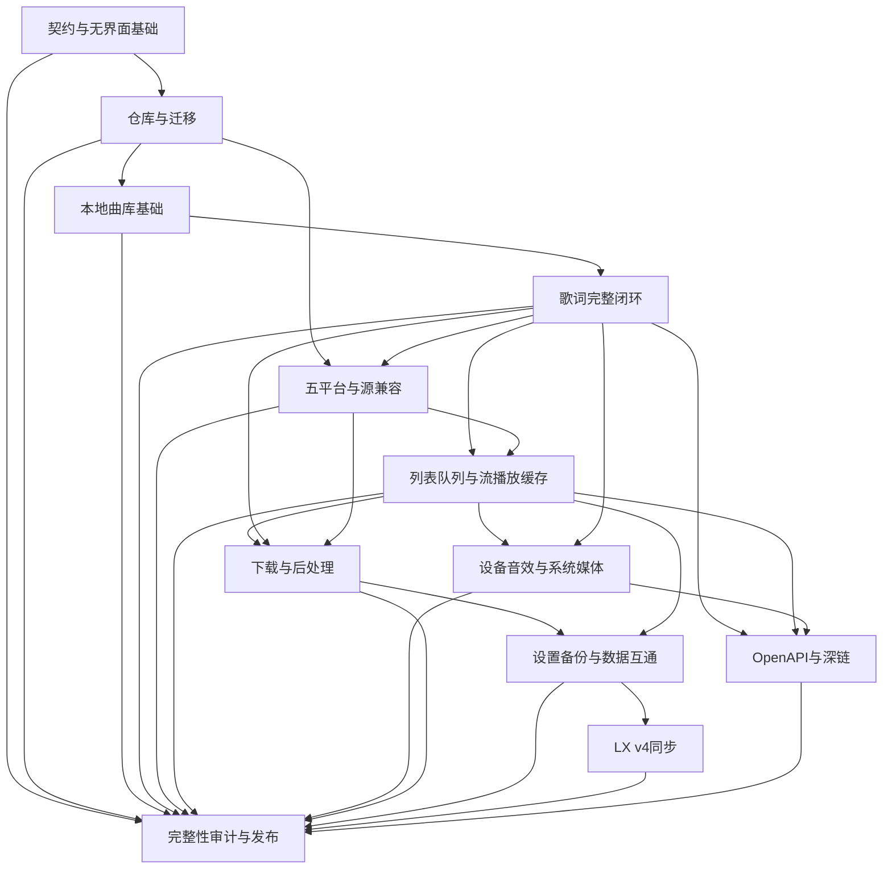

# LX Native 完整后端移植工程规划

状态：**后端实施计划**。规划日期：2026-10-06，功能盘点基线为0.2.0。当前开发版本为0.3.0-alpha.14，已接入独立后端、事务仓、本地/在线歌词、五平台SDK、持久五模式队列、块流式播放、已批准源预加载、跨平台匹配、URL/图片缓存、编码复用、有限HTTP恢复及设备选择/热切换/静音、十段EQ、倍速保调及独立移调、目录授权、后台扫描入库和独立许可的本地标签编辑；具体实现与剩余边界见[后端开发状态](../docs/backend-status.md)。本地匹配、其他异常恢复分支、设备实机验收/其余音效、下载和同步等工作继续按里程碑推进，完整LX兼容尚未完成。前端布局、视觉、交互原型及桌面歌词窗口设计安排在后端验收之后。

唯一参考基线为官方 LX Music Desktop v2.12.6 提交 [`ad95d5091c9ed689fa72b5e5c849df65f5a679ce`](https://github.com/lyswhut/lx-music-desktop/tree/ad95d5091c9ed689fa72b5e5c849df65f5a679ce)。下文上游源码链接固定在该提交。“上游有实现”“Rust 已实现”“离线契约测试通过”“真实服务联测通过”是四种不同状态，必须分别记录。

## 0. 产品范围与实施总览

完整后端交付包括五平台音乐元数据、自定义音源兼容、歌词、音频与队列、用户列表与本地曲库、下载、缓存与数据仓库、数据互通、同步、外部控制及发布运行基础。功能范围以固定 LX 版本有效导出的行为为准；Any Listen 的 WebDAV 等功能属于独立扩展，另行立项。参考发布基线见 [LX Releases](https://github.com/lyswhut/lx-music-desktop/releases/tag/v2.12.6)；界面依赖维持已锁定的 [GPUI Kit 0.7.0](https://github.com/longbridge/gpui-kit/releases/tag/v0.7.0)。

| 工作域 | 完整交付内容 | 实施位置 |
| --- | --- | --- |
| 基础服务 | 稳定音乐模型、命令与事件、结构化错误、SQLite、设置迁移、任务取消、无界面命令入口 | M00–M01 |
| 本地库与歌词 | 稳定文件身份、标签/封面/旁车、四轨歌词、格式转换、原文/编辑、歌词时钟、导入导出 | M02–M03 |
| 在线音乐与音源 | kw/kg/tx/wy/mg 有效搜索/榜单/歌单/详情/评论能力、质量选择、换源、解析缓存、自定义源尾项 | M04–M05 |
| 用户数据与播放 | 歌单/收藏/不喜欢/历史、排序去重、五模式队列、临时插队、流式加载、预加载、异常恢复 | M05 |
| 音频与系统媒体 | 设备选择/变化、倍速保调、音效、媒体会话、快捷键、定时停止、电源状态 | M06 |
| 下载 | 任务持久化、限并发、续传、暂停/重试、路径命名、歌词输出、封面/标签后处理 | M07 |
| 互通与同步 | LX 四类 v2 备份、旧格式迁移、CSV、项目备份、LX v4 客户端/服务端与冲突合并 | M08–M09 |
| 外部接口 | 13 个 LX OpenAPI 路由、SSE、深链、统一控制接口 | M10 |
| 交付运行 | 数据目录、实例锁、迁移/恢复、便携包、依赖许可、资源限额、完整回归与实机验收 | M11 |

现有 GPUI 窗口只通过适配层调用后端。现阶段可以修改必要的命令映射和数据投影，验收使用 Rust 服务、CLI 和集成测试；不新增页面、绘制界面或重做现有视觉。后端首个运行平台为 Windows x64/MSVC，纯领域与服务模块保持平台独立；macOS/Linux 的音频、系统集成及发行包各自经过实机验收后建立支持状态。

首批范围为 M00–M03：先建立可独立启动的后端、事务数据仓和稳定本地文件模型，再完成本地歌词闭环。在线平台、下载、同步均列为必交付工作域，不以本地播放器原型替代完整移植。

## 1. 目标、基线与完成定义

完整移植的工程目标是覆盖该固定版本的有效后端行为：平台数据提供器、音源运行时、歌词、播放状态机、列表与本地文件、缓存、下载与标签、设置与数据迁移、导入导出、同步以及系统控制接口。Electron/Vue/DOM 细节转换为 Rust 服务与事件；后续 GPUI/GPUI Kit 仅消费这些接口。

“完整”需要按本文矩阵逐项验收：可用功能具有真实执行链路；上游已关闭功能明确标记关闭；依赖平台权限或实机设备的功能有独立联测结果；因授权或运行时边界无法支持的功能公开列出，不能用一个 `.js` 文件导入成功推导任意 LX 源可用。

| 当前基础 | 已有 Rust 实现 | 待移植能力 |
| --- | --- | --- |
| 曲目与搜索 | `src/catalog.rs`：合法合成曲目、本地文件导入、标题/作者/专辑搜索、局部旧版 LX DTO 转换 | 曲目模型只有本地/合成字段；本地标题取文件名，未读真实艺术家、专辑、封面、歌词标签；本地 ID 随进程导入次序生成 |
| 音源 | `source.rs`、`worker.rs`、`source_bootstrap.js`：静态导入、按内容绑定授权、初始化/启停/切换/删除、独立进程与超时、请求分发 | 当前响应主要为 URL 字符串；未完成本地 `lyric` 对象响应、RSA、受控 timers、完整 Buffer、更新提示事件等兼容尾项 |
| 源网络/工具 | `source_http.rs`、`source_utils.rs/.js`：受控异步 HTTP、取消/丢弃过期回调、常用 Buffer、MD5、AES、zlib | 已实现能力有明确限额与安全差异；完整说明见 [音源契约](../docs/upstream-contract.md)，不能等同浏览器/Node 全环境 |
| 播放 | `audio.rs`、`controller.rs`：真实解码、设备输出路径、播放/暂停/停止/切歌/跳转/音量、过期操作隔离 | 全量音频加载上限 64 MiB/20 秒；没有持续流式缓存、五种队列模式、临时插队/随机历史、倍速保调、DSP、设备选择、歌词时钟 |
| 持久化 | `store.rs`：版本化 JSON、原子替换、备份恢复；源、选择项、本地路径和音量恢复 | 没有歌曲/列表/歌词/URL/换源关系/下载任务的事务数据仓库，没有完整设置与迁移、LX 备份格式和同步 |
| 检验基础 | 0.2.0 留存记录为 82 项常规测试通过，fmt/check/build 通过；原生截图已验证 | 留存诊断未取得真实输出端点，硬件播放为 `BLOCKED`；后续硬件环境重新验收；新规划能力均未实现/未运行，参见 [验证记录](../docs/validation.md) |

## 2. 上游模块版图与逐项兼容矩阵

路径按职责列出，历史文件、未导出代码或临时版本不计为可用功能。下表保留0.2.0功能盘点基线，开发版本的实际接入与验收状态由[后端开发状态](../docs/backend-status.md)记录。

| 编号/模块 | 固定上游入口与关键源码 | Rust 当前状态 | 移植交付与验收 |
| --- | --- | --- | --- |
| B01 统一音乐模型 | [`common/types/music.d.ts`](https://github.com/lyswhut/lx-music-desktop/blob/ad95d5091c9ed689fa72b5e5c849df65f5a679ce/src/common/types/music.d.ts)、[`common/utils/tools.ts`](https://github.com/lyswhut/lx-music-desktop/blob/ad95d5091c9ed689fa72b5e5c849df65f5a679ce/src/common/utils/tools.ts) | 部分：本地 `Track` 和旧 DTO | 现代与旧脚本 DTO 双向转换；数字/字符串平台 ID、质量及平台特有标识不丢失；旧 `flac32bit` 迁移明确 |
| B02 平台搜索/热搜/建议/评论 | [`renderer/utils/musicSdk/index.js`](https://github.com/lyswhut/lx-music-desktop/blob/ad95d5091c9ed689fa72b5e5c849df65f5a679ce/src/renderer/utils/musicSdk/index.js)、各平台 `musicSearch.js/hotSearch.js/tipSearch.js/comment.js` | 本地搜索有；在线五平台未移植 | 分页、总数、排序、取消、平台错误及空结果；能力声明与平台实际导出一致；搜索属于 SDK，不属于自定义源 `request` action |
| B03 有效歌曲详情与专辑路由 | 各平台 `index.js/musicInfo.js/musicDetail.js` 及活动歌单中的专辑分支，见下一表 | 未移植 | 保留平台质量、hash、albumAudioId、strMediaMid、copyrightId 等后续解析必需字段；未导出且无活动调用的 singer/历史 album 文件不计必达能力；独立歌手浏览列为项目扩展 |
| B04 榜单/在线歌单/歌单搜索与导入 | 各平台 `leaderboard.js/songList.js`；[`renderer/store/list/syncSourceList.ts`](https://github.com/lyswhut/lx-music-desktop/blob/ad95d5091c9ed689fa72b5e5c849df65f5a679ce/src/renderer/store/list/syncSourceList.ts)、[`core/useApp/listAutoUpdate.ts`](https://github.com/lyswhut/lx-music-desktop/blob/ad95d5091c9ed689fa72b5e5c849df65f5a679ce/src/renderer/core/useApp/listAutoUpdate.ts) | 未移植 | 分类/排序/分页/详情、URL或ID导入、来源列表映射及自动刷新；完整分页后才提交，不用第一页覆盖完整列表 |
| B05 URL解析/质量/换源/封面 | [`renderer/core/music/online.ts`](https://github.com/lyswhut/lx-music-desktop/blob/ad95d5091c9ed689fa72b5e5c849df65f5a679ce/src/renderer/core/music/online.ts)、[`music/utils.ts`](https://github.com/lyswhut/lx-music-desktop/blob/ad95d5091c9ed689fa72b5e5c849df65f5a679ce/src/renderer/core/music/utils.ts)、SDK `api-source.js/api-source-info.ts` | 自定义源 URL 和局部 pic 支持；在线路由/缓存/匹配未移植 | 来源路由、质量交集/降级、刷新失效URL、匹配排序、请求取消；封面有文件/标签/平台/源优先级和独立缓存 |
| B06 自定义源完整生命周期 | [`main/modules/userApi/renderer/preload.js`](https://github.com/lyswhut/lx-music-desktop/blob/ad95d5091c9ed689fa72b5e5c849df65f5a679ce/src/main/modules/userApi/renderer/preload.js)、[`userApi/utils.ts`](https://github.com/lyswhut/lx-music-desktop/blob/ad95d5091c9ed689fa72b5e5c849df65f5a679ce/src/main/modules/userApi/utils.ts)、[`renderer/core/apiSource.ts`](https://github.com/lyswhut/lx-music-desktop/blob/ad95d5091c9ed689fa72b5e5c849df65f5a679ce/src/renderer/core/apiSource.ts) | 核心纵向链路已完成，能力子集 | 扩展类型化 `local.lyric`；RSA/helper/timer/事件逐项建立 fixture；每项权限/限额有记录；新增能力策略版本变化使旧授权重新评估 |
| B07 歌词获取/转换/解析/编辑 | [`core/music/local.ts`](https://github.com/lyswhut/lx-music-desktop/blob/ad95d5091c9ed689fa72b5e5c849df65f5a679ce/src/renderer/core/music/local.ts)、[`common/utils/lyric-font-player/index.js`](https://github.com/lyswhut/lx-music-desktop/blob/ad95d5091c9ed689fa72b5e5c849df65f5a679ce/src/common/utils/lyric-font-player/index.js)、`lyricUtils` 和平台 `lyric.js` | 未移植 | 四种歌词、格式转换、时间标签、编辑覆盖与原文恢复；详细闭环见第 5 节 |
| B08 歌词缓存/播放同步/对外状态 | [`dbService/modules/lyric/index.ts`](https://github.com/lyswhut/lx-music-desktop/blob/ad95d5091c9ed689fa72b5e5c849df65f5a679ce/src/main/worker/dbService/modules/lyric/index.ts)、[`usePlayer/useLyric.ts`](https://github.com/lyswhut/lx-music-desktop/blob/ad95d5091c9ed689fa72b5e5c849df65f5a679ce/src/renderer/core/useApp/usePlayer/useLyric.ts)、[`main/modules/winLyric/index.ts`](https://github.com/lyswhut/lx-music-desktop/blob/ad95d5091c9ed689fa72b5e5c849df65f5a679ce/src/main/modules/winLyric/index.ts) | 未移植 | raw/edited持久化、缺字段升级重取、offset/暂停/seek/倍率同步、行与字进度事件；桌面歌词窗口显示留到后续界面阶段 |
| B09 播放队列与恢复策略 | [`renderer/core/player/action.ts`](https://github.com/lyswhut/lx-music-desktop/blob/ad95d5091c9ed689fa72b5e5c849df65f5a679ce/src/renderer/core/player/action.ts)、[`player/utils.ts`](https://github.com/lyswhut/lx-music-desktop/blob/ad95d5091c9ed689fa72b5e5c849df65f5a679ce/src/renderer/core/player/utils.ts)、`store/player`、`usePlayer/usePreloadNextMusic.ts`、`timeoutStop.ts` | 简单前后切歌/播放完成切歌 | `listLoop/random/list/singleLoop/none`、临时插队、历史、删除当前项、dislike、手动与自动切歌不同语义、预加载、恢复播放进度、定时停止 |
| B10 音频设备/倍速/音效/媒体状态 | [`renderer/plugins/player/index.ts`](https://github.com/lyswhut/lx-music-desktop/blob/ad95d5091c9ed689fa72b5e5c849df65f5a679ce/src/renderer/plugins/player/index.ts)、`pitch-shifter`、`usePlayer/useMediaDevice.ts/useSoundEffect.ts/useMediaSessionInfo.ts` | rodio解码、输出、常规控制有 | 设备选择/变化/失效策略、倍率与保调、十段EQ/卷积/空间声/移调、分析数据、系统媒体控制；DSP替代实现需标明差异和数值验收 |
| B11 列表/收藏/dislike/搜索历史 | [`common/types/list.d.ts`](https://github.com/lyswhut/lx-music-desktop/blob/ad95d5091c9ed689fa72b5e5c849df65f5a679ce/src/common/types/list.d.ts)、`renderer/store/list`、[`main/event/ListEvent.ts`](https://github.com/lyswhut/lx-music-desktop/blob/ad95d5091c9ed689fa72b5e5c849df65f5a679ce/src/main/event/ListEvent.ts)、`DislikeEvent.ts`、`dbService/modules/list/dislike_list` | 未移植；现有queue不是持久化用户歌单 | default/love/temp/user列表与顺序、增删移动去重、位置、来源更新时间、不喜欢规则、历史；事务提交后发事件 |
| B12 本地曲库/标签/封面/旁车 | [`renderer/utils/music.ts`](https://github.com/lyswhut/lx-music-desktop/blob/ad95d5091c9ed689fa72b5e5c849df65f5a679ce/src/renderer/utils/music.ts)、[`core/music/local.ts`](https://github.com/lyswhut/lx-music-desktop/blob/ad95d5091c9ed689fa72b5e5c849df65f5a679ce/src/renderer/core/music/local.ts)、`common/utils/musicMeta` | 文件导入/解码有；标签读取写入未移植 | 用户选择目录/文件后建立索引；稳定本地ID、去重与变更扫描、标签/封面/歌词、缺失文件处理、写入回滚；不扫描私人目录 |
| B13 下载/续传/歌词与标签后处理 | [`renderer/store/download/action.ts`](https://github.com/lyswhut/lx-music-desktop/blob/ad95d5091c9ed689fa72b5e5c849df65f5a679ce/src/renderer/store/download/action.ts)、[`common/utils/download/Downloader.ts`](https://github.com/lyswhut/lx-music-desktop/blob/ad95d5091c9ed689fa72b5e5c849df65f5a679ce/src/common/utils/download/Downloader.ts)、`renderer/worker/download/download.ts`、`common/types/download_list.d.ts`、`dbService/modules/download` | 未移植；播放加载不是下载管理器 | 持久化任务、限并发、暂停/继续/取消/重试、Range续传、文件名/目录策略、LRC/LX/翻译/罗马音输出、MP3/FLAC标签及下载完成后的本地播放 |
| B14 缓存与数据仓库 | [`main/worker/dbService/tables.ts`](https://github.com/lyswhut/lx-music-desktop/blob/ad95d5091c9ed689fa72b5e5c849df65f5a679ce/src/main/worker/dbService/tables.ts)、[`db.ts`](https://github.com/lyswhut/lx-music-desktop/blob/ad95d5091c9ed689fa72b5e5c849df65f5a679ce/src/main/worker/dbService/db.ts)、`migrate.ts/verifyDB.ts`、`renderer/utils/ipc.ts` | JSON配置仓有；结构数据仓无 | SQLite迁移/事务/完整性检查、歌词/URL/换源关系/列表/任务；独立音频与封面缓存配额、失效和清理；不可把清raw歌词等同清edited |
| B15 设置/备份/导入导出/迁移 | [`common/defaultSetting.ts`](https://github.com/lyswhut/lx-music-desktop/blob/ad95d5091c9ed689fa72b5e5c849df65f5a679ce/src/common/defaultSetting.ts)、`types/app_setting.d.ts`、`common/utils/migrateSetting.ts`、`main/utils/store.ts/migrate.ts`、`SettingBackup.vue`、`renderer/worker/main/common.ts`、`common/utils/nodejs.ts`、`renderer/worker/main/list.ts` | 少量设置保存；LX格式未移植 | 完整设置映射与校验、LX类型化备份/分列表/文本CSV、旧版本迁移、预览冲突和原子提交；下载任务备份作为项目扩展单独标记，格式与范围见第 8 节 |
| B16 同步服务端/客户端/快照 | [`main/modules/sync/index.ts`](https://github.com/lyswhut/lx-music-desktop/blob/ad95d5091c9ed689fa72b5e5c849df65f5a679ce/src/main/modules/sync/index.ts)、`server/client`、[`common/constants_sync.ts`](https://github.com/lyswhut/lx-music-desktop/blob/ad95d5091c9ed689fa72b5e5c849df65f5a679ce/src/common/constants_sync.ts)、`types/list_sync.d.ts/dislike_list_sync.d.ts` | 未移植 | v4协议、首次同步策略、增量事件/快照/撤销配对/重连；只覆盖上游list/dislike，歌词与播放时钟不在此协议范围 |
| B17 OpenAPI/深链/快捷键/系统集成 | [`main/modules/openApi/index.ts`](https://github.com/lyswhut/lx-music-desktop/blob/ad95d5091c9ed689fa72b5e5c849df65f5a679ce/src/main/modules/openApi/index.ts)、`common/types/open_api.d.ts`、`core/useApp/useDeeplink`、`main/modules/hotKey/index.ts`、`main/modules/tray.ts` | 未移植 | HTTP状态/歌词/播放控制/SSE、深链解析、快捷键命令与媒体会话、阻止休眠；外部入口复用服务命令与授权策略，不直接访问播放器内部可变状态 |

上游自动更新、托盘图标、桌面歌词窗口、主题、窗口状态等分别包含产品发布或界面职责。后端提供必要状态和控制接口；窗口和视觉适配留到后续界面阶段。产品自动更新需独立发布体系，不复用上游更新地址；系统注册及服务监听仅在用户启用相关能力时执行。

### 2.1 五个平台 SDK 的具体文件边界

以下目录都在 `src/renderer/utils/musicSdk/` 下。所有五平台都有 `musicSearch.js/leaderboard.js/songList.js/lyric.js/hotSearch.js/comment.js`。`tipSearch.js` 文件存在不等于对外能力：固定版本 `index.js` 只有 kw 导出建议搜索；其余导出语句已注释。详情入口不统一，必须按平台 adapter 明确能力，不能虚构一个所有平台都可用的 `songDetail`。

| 平台/固定目录链接 | 详情及歌单内部使用模块 | 封面/歌词分工 | 特别保留字段/状态 |
| --- | --- | --- | --- |
| [kw](https://github.com/lyswhut/lx-music-desktop/tree/ad95d5091c9ed689fa72b5e5c849df65f5a679ce/src/renderer/utils/musicSdk/kw) | `index.js` 中 `getMusicInfo/handleMusicInfo`，`album.js`、`util.js`；songList分流专辑和多种歌单类型 | `pic.js`、`lyric.js` | songmid、albumId、qualitys；唯一已导出的tipSearch |
| [kg](https://github.com/lyswhut/lx-music-desktop/tree/ad95d5091c9ed689fa72b5e5c849df65f5a679ce/src/renderer/utils/musicSdk/kg) | 活动 `musicInfo.js/util.js`；`album.js` 仅历史 temp 歌单模块调用，`singer.js` 无活动调用，均不列必达 | `pic.js`、`lyric.js`；KRC规范化 | 各quality hash、albumAudioId、hash；签名辅助文件单独锁定契约与许可 |
| [tx](https://github.com/lyswhut/lx-music-desktop/tree/ad95d5091c9ed689fa72b5e5c849df65f5a679ce/src/renderer/utils/musicSdk/tx) | 活动 `musicInfo.js`、歌单路由；`singer.js` 未导出且无活动调用 | index按albumId构建封面；`lyric.js/qrcDecode.js/utils/crypto.js` | strMediaMid、id、albumMid及质量；QRC处理仅用于获授权歌词数据 |
| [wy](https://github.com/lyswhut/lx-music-desktop/tree/ad95d5091c9ed689fa72b5e5c849df65f5a679ce/src/renderer/utils/musicSdk/wy) | 活动 `musicInfo.js/musicDetail.js/utils/crypto.js`；`singer.js` 未导出且无活动调用 | getPic通过详情al.picUrl；`lyric.js` | 数字歌曲ID、albumId、qualitys；字级歌词和普通歌词分别保留 |
| [mg](https://github.com/lyswhut/lx-music-desktop/tree/ad95d5091c9ed689fa72b5e5c849df65f5a679ce/src/renderer/utils/musicSdk/mg) | 活动 `musicInfo.js/songId.js/utils/index.js`；`album.js` 无活动调用，不列必达 | `pic.js/lyric.js/utils/mrc.js` | copyrightId、lrcUrl/mrcUrl/trcUrl，不用一个songmid替换所有标识 |

历史 `bd` 目录仍被对象导入，但 sources 列表项已注释；`xm.js` 仍有列表项，核心方法明确 reject/fail，跨平台匹配也排除 xm。它们记为“上游关闭/占位”，保留旧数据标识和明确错误，不以存在源码为依据恢复已关闭平台。

在线 URL 在五个平台 `index.js` 中通过 `apis(platform).getMusicUrl` 路由到选定自定义源。平台 SDK 提供搜索等音乐元数据，自定义源不自动获得搜索能力。平台接口请求字段、签名及外部服务可能变化；固定源码移植与实时可用性分开测试。当前线上能力状态为未实现、未联测。

评论验收区分普通、热门、内嵌回复及平台游标分页；WY 的 cursor/page 顺序保留，不能仅套用统一页码。KG/MG 的独立回复方法由 nested object 导出，作为 SDK 可调用能力记录，活动界面未使用的分支单独验收。来源列表 `board__` 前缀按榜单解析；自动更新对应启动时依列表顺序处理 `isAutoUpdate` 项，失败不覆盖旧列表或更新时间。周期刷新属于扩展调度。

## 3. Rust 后端边界、数据模型与错误协议

以下是待实施设计，不是已经添加的 Rust API。优先保持单个工程的模块边界；模块稳定后再决定是否拆 workspace crate，避免第一阶段重构全部前端。

### 3.1 数据模型

| 模型 | 设计内容与上游映射 |
| --- | --- |
| `TrackRecord` / `PlatformTrackRef` | 稳定内部UUID + `lx_id`兼容ID；标题、艺术家列表、专辑、时长毫秒、source枚举、平台ID（字符串/整数无损）、质量集合、平台专属meta及版本。平台 DTO 与领域模型分开，未知meta保留扩展字段 |
| `LocalAsset` | 用户授权文件/目录范围、规范化路径、文件大小/mtime/可选内容指纹、格式、读到的标签、文件可用状态；URI/磁盘路径与曲目身份分开，不持久化随机loopback端口 |
| `Playlist` / `PlaylistEntry` | default/love/temp/user类别、来源sourceListId、名称、顺序、更新时间、条目稳定ID/track引用；列表操作用事务和版本，兼容LX列表的去重语义 |
| `SourceInstallation` / `SourceSession` | 脚本字节/摘要、元数据、授权策略版本、manifest、session generation和状态。字节安装与可执行session分开；导入/恢复安装记录不自动执行 |
| `ResolvedMedia` | URL、实际平台与质量、resolver身份/版本、可选过期时间、创建时间、内容类型、解析trace；保留缓存失效理由。输出需要headers等扩展时先明确上游并非当前URL-string契约，再用项目扩展字段标识 |
| `LyricBundle` / `LyricDocument` | 四通道 `lyric/tlyric/rlyric/lxlyric` 的原文、空/不支持/未获取状态；raw/edited、来源/编码、file offset、parser revision。解析后是行、相对词时间和扩展文本，见第5节 |
| `PlaybackSnapshot` | generation、曲目/列表/队列引用、Idle/Resolving/Buffering/Playing/Paused/Ended/Error、position/duration/rate、设备、错误与seek_seq。音频时钟是歌词和系统状态的唯一进度来源 |
| `DownloadJob` | job ID、track与目标quality、目标路径/临时文件、Queued/Resolving/Downloading/Paused/Finalizing/Complete/Failed/Cancelled、已收字节/总量、校验信息、错误、后处理状态 |
| `Settings` / `RepositoryRevision` | 类型化后端设置、默认值、合法范围和兼容未知键；独立schema版本。同步版本与数据库版本分开；授权、密钥、用户路径不随普通备份自动导出 |

上游音乐 `interval` 是显示字符串；领域时间统一整数毫秒，转换器保留原interval便于往返。上游列表/导入/同步数据中的LX ID必须维持，不把内部UUID直接写进兼容协议。本地ID上游使用路径：兼容导入保留原值，项目内部使用稳定ID与路径映射，以便搬移文件和避免重启后ID漂移。

### 3.2 服务/trait 边界

| 边界 | 主要方法（签名意图） | 禁止承担的职责 |
| --- | --- | --- |
| `MusicProvider` | `capabilities/search/search_playlists/hot_search/suggest/song_detail/charts/chart_tracks/playlist_detail/album/comments/lyric/picture`；保留平台 cursor 的 `Page<T>` + `ProviderError`；artist 扩展单独声明 | 不执行用户JS，不管理用户列表，不决定播放状态 |
| `SourceResolver` | `initialize/resolve_url/local_picture/local_lyric/cancel/shutdown`；返回类型化结果；session generation贯穿IPC | 不宣称search属于lx事件，不获得全磁盘/凭证/系统shell权限 |
| `MusicService` | 统一 local/download/online 路由；缓存、质量选择、换源匹配、刷新及操作trace | 不实现平台JSON细节，不写播放器设备 |
| `LyricService` / `LyricParser` / `LyricTimeline` | 获取与优先级/编辑与仓库；纯函数parse/convert；`update(clock)->LyricFrame`含行/字索引与进度 | 不以墙钟独立推进，不依赖DOM/setTimeout，不通过syncserver假定歌词被同步 |
| `AudioEngine` / `QueueService` | engine负责load/control/device/clock；queue负责模式/历史/插队/跳过规则/下一首预选；controller编排二者 | 下载完成回调不直接替换已变更曲目，不把UI列表当唯一队列真源 |
| `MusicRepository` / `SettingsStore` / `CacheStore` | 有版本的事务、CRUD、原子迁移、缓存key/失效；工作线程串行写事务 | GPUI主线程不阻塞I/O；清缓存不删除编辑歌词、列表或源授权 |
| `LocalLibrary` / `TagReader` / `TagWriter` | 授权范围内扫描/增量更新、标签读取、旁车读取；写标签先临时副本验证再原子替换 | 不读取用户未选目录，不将其他格式一律改写为MP3 |
| `DownloadManager` / `DownloadTransport` | 队列并发/持久化/状态机；HTTP传输与续传校验；后处理依赖LyricService/TagWriter | 不绕过解析授权，不将普通play缓存误当用户明确下载，不假报后处理失败的任务完整成功 |
| `ImportExportService` / `SyncService` | 解码验证/计划预览/事务apply；协议认证/增量/冲突/快照/重连 | 导入不执行脚本，不从其他应用私有配置自动读密钥，不吞掉冲突覆盖本地 |
| `SystemControlAdapter` / `BackendEventBus` | OpenAPI/媒体键/快捷键/深链转统一 `BackendCommand`；订阅不可变事件与snapshot | 外部入口不得绕过命令校验、授权和队列事务 |

异步操作统一 `OperationContext { operation_id, session_generation, track_generation, cancellation, deadline }`。网络、JS进程、歌词与封面请求、下载和预加载都检查取消及generation；不把 `JsValue` 跨线程，不让队列完成消息无界增长。当前源HTTP的受控 start/cancel/poll 架构保留，类型化返回时增加负载大小和递归深度校验。

错误采用明确类别：Cancelled、Timeout、UnsupportedCapability、PermissionRequired、RateLimited、Unavailable、NotFound、InvalidData、Network/Tls、Decode、DeviceUnavailable、Storage/Conflict。附可安全展示的信息、是否可重试、实际来源和有限trace；URL查询参数、授权header、密钥和本地完整路径不进入常规日志。取消不显示为播放失败；歌词/封面失败不会中断已正常播放的音频。

### 3.3 后端入口与命令契约

领域、服务、仓库不引用 `UiCommand`、`UiSnapshot`、GPUI 类型或 `rfd` 文件对话框。文件选择发生在入口适配器；后端接收显式路径和处理选项。`ui` Cargo feature 控制 GPUI、界面和文件对话框依赖；后端提供不加载 GPUI、也不打开窗口的构建与验收入口。现有 `ControllerHandle` 通过适配器迁移，已有音源与播放功能持续保留回归。

| 接口 | 契约 |
| --- | --- |
| `Backend::start(config)` | 返回 handle、初始快照和启动结果；配置包含 data_dir、音频模式及服务开关；硬件不可用时纯数据服务仍可启动 |
| `execute(CommandEnvelope)` | envelope 含 request_id、origin、expected_revision、command；返回 receipt，区分已拒绝/已接受/已提交；长任务返回 operation_id，完成另发事件 |
| `query(Query)` | 查询快照、能力、分页曲库/列表/任务、歌词、设置及服务状态；不隐式写数据或执行脚本 |
| `subscribe(cursor, filters)` | 返回不可变事件；带序号及领域 revision；游标过期明确返回重取快照需求 |
| `cancel(operation_id)` | 幂等；取消关联网络、源请求及临时写入；取消之后不提交对应任务的业务结果 |
| `shutdown(deadline)` | 停止接收新命令、取消任务、保存可恢复状态、关闭监听/子进程/音频、等待线程退出并关闭数据库 |

命令覆盖播放控制/模式/队列、列表/收藏/不喜欢、本地导入/重扫、歌词编辑/恢复/导出、源导入/授权/选择、下载调度、设置、备份/恢复、同步配对/撤销和服务启停。查询与修改分离；每种修改标明事务边界、revision 冲突语义和可重试条件。UI、CLI、OpenAPI、媒体键只转换命令，不自行实现第二套播放逻辑。

统一事件包括 `PlaybackChanged`、`QueueChanged`、`LibraryChanged`、`PlaylistChanged`、`LyricChanged`、`LyricFrameChanged`、`SourceChanged`、`DownloadChanged`、`SettingsChanged`、`SyncChanged`、`ServiceChanged`、`OperationFinished`。持久化修改只在事务提交后发出；带 origin 防止同步回声。进度/歌词帧事件可合并，列表/下载/事务事件不得静默丢失；慢消费者在有界队列溢出后收到重新同步通知。

### 3.4 SQLite 与既有数据迁移

SQLite 使用外键、迁移序号和串行写入器。下面为目标逻辑表；分阶段建表，每张实际表的 DDL、索引、升级和回滚测试随对应里程碑进入源码。带敏感授权的源安装数据沿用独立版本化仓，数据库只引用摘要与安装 ID，避免产生两份互相矛盾的批准状态。

| 表组 | 键与约束 | 主要字段/行为 |
| --- | --- | --- |
| `schema_migrations` / `migration_runs` | version 唯一；迁移任务 ID 唯一 | 输入 schema、完成标记、校验摘要、恢复点；未知新版本拒绝写入 |
| `tracks` / `platform_refs` | 稳定 track_id；平台自然标识保留；lx_id 独立映射 | 标题/艺术家/专辑/时长、质量、完整平台 meta、revision；平台导入不丢失解析字段 |
| `local_assets` / `library_roots` | asset_id 稳定；规范化路径与文件身份映射 | 大小/mtime/指纹/标签/可用状态、扫描范围；路径失效不删除关联用户列表 |
| `playlists` / `playlist_entries` | list_id；(list_id,entry_id)；顺序索引 | 列表类别、来源、更新时间、track_id、position；兼容列表去重不套用到允许重复的播放队列 |
| `queue_state` / `queue_entries` / `playback_history` | 播放项身份独立于 track_id | 当前游标、临时队列、随机预选、历史和恢复点；重启不自动发声 |
| `dislike_rules` / `search_history` | 规范化规则去重；搜索项 MRU | LX 文本规则与别名；搜索历史最多 15 项、可清空 |
| `lyric_bundles` / `lyric_channels` | (track_id,origin) 包；(bundle_id,kind) 轨唯一 | origin=raw/edited；保留 missing/null/empty/text 状态、四轨及获取来源/parser/edit revision；整包事务替换 |
| `resolved_media` / `source_matches` | 平台+曲目+质量+resolver 摘要/版本 | URL/有效期、失效原因、实际换源候选、匹配版本；临时 URL 与脚本凭证不进普通备份 |
| `cache_entries` | 类型+key 唯一 | 文件路径、字节数、访问时间、过期与 pin；下载正式文件和编辑歌词不属于可清缓存 |
| `download_jobs` / `download_steps` | job_id；任务去重键独立定义 | transfer 与后处理状态、目标/part 路径、Range 校验、字节数、失败原因及重试状态 |
| `sync_devices` / `sync_snapshots` / `sync_cursors` | 设备/内容摘要/模块 revision | 引用中的快照不被清理；凭证使用独立安全存储；list/dislike ready 分开记录 |
| `repository_changes` | 单调 revision；事务内生成 | 领域变更摘要/outbox，恢复订阅和同步游标；过期保留策略不得截断活跃设备所需状态 |
| `operations` | request_id/operation_id 唯一 | 受理/终态结果及恢复策略；重复请求不重复写入；无恢复意义的读取型临时操作不长期落库 |

0.2.0 JSON 中 sources/selected 迁入独立安装仓引用，volume 迁入类型化设置，local_files 建立 stable asset/track 映射。恢复选中源只恢复仍有效的内容批准；路径缺失单独记录。迁移先备份、验证新仓、写入完成标记，再切换读取入口；重复启动不重复导入，失败仍可读取原文件。现有合成曲目 ID 固定，loopback URL 在每次启动重新生成。

### 3.5 调度、并发与停止

共享 `JobScheduler` 管理播放解析、歌词/封面、预加载、扫描、列表自动更新和后台清理；下载使用独立限并发队列。播放/暂停/停止/seek 控制命令不排在慢 I/O 后面。网络重试必须带取消、总期限、次数上限和 jitter；读取型任务可以合并相同请求，修改和写文件任务按业务 ID 保持幂等。

一个启用音源对应一个保留状态的 JS 会话，保留 LX 闭包和后注册覆盖语义。现有 worker 在新请求开始时取消上一请求的后台 HTTP，扩展歌词/封面/预加载前必须处理这一冲突：首版在会话内串行请求并优先播放，随后采用 operation_id 隔离回调和取消；不得让歌词请求终止正在解析的播放 URL，也不得以复制多个会话掩盖可观察状态差异。每个操作在现有 HTTP 并发/次数限额内执行，取消只影响对应操作，撤权/停用则终止整个会话。

命令、任务完成、事件和网络回调通道全部有容量及溢出策略；不再使用无界通道承载持续进度。关闭顺序为入口→任务取消→worker/网络/音频→持久化恢复点→DB关闭；线程 join 和子进程退出有总期限。异常关机后下载恢复为暂停，服务监听按显式启用设置恢复，源批准仍以内容和策略版本校验。

### 3.6 无界面验证与容量门槛

新增独立 CLI，支持 JSON Lines 命令输入/结果输出，以及 `status`、`capabilities`、`import-local`、`search`、`playlist`、`queue`、`lyrics`、`download`、`backup`、`sync` 和 `diagnose`。每次运行使用明确 profile；变更命令显式传参数，不复用 UI 文件对话框。离线音频模式使用内存 PCM/可控时钟，实机模式独立验证默认和指定设备；离线通过不代表扬声器发声通过。

阶段验收使用 50,000 条合成曲目、10,000 条单列表、100 项持久化下载任务与大于 64 MiB 的合法音频 fixture。目标为快照/控制在慢网络和扫描期间仍可响应、分页不复制全库、任务/内存/缓存始终受限、重复订阅取消无净增长、关闭后无遗留 worker/线程/监听。M00 记录测试机器与初始测量；控制响应 p95 目标 100 ms、正常关闭目标 5 秒，实测偏离时必须处理原因并记录结果，不能仅修改目标宣称达标。具体内存与磁盘配额随基线测量锁定，不取消现有 worker 512 MiB 限额。

## 4. 平台路由、质量、换源与缓存

平台 adapter 先把固定官方响应规范化到统一模型，再做应用行为。每个平台建立纯解析fixture与HTTP契约fixture：合法自建JSON响应、分页空结果、缺字段/类型错、重复条目、超时/取消/429/服务端错误。未获允许时不将真实接口测试加入默认测试，也不引入别人提供的源脚本。

上游 `musicSdk/index.js` 的 `searchMusic/findMusic` 会并发查询其他有效平台，按标题、艺术家、专辑、时长和版本词排序；时长允许约5秒差异。移植时把规范化及排序做成确定纯函数，保留实际匹配track/平台及匹配理由，覆盖Live/Remix/伴奏等版本不同不能误配的fixture。跨平台匹配只找可访问的同作品数据，不构成付费/DRM访问授权。

质量选择以设置、曲目质量元数据、resolver manifest三者的交集为准。固定源码的主要源契约为128k/320k/flac/flac24bit；通用历史数据还可能包含192k/ape/wav。将历史quality保留在DTO，解析器没有能力时返回明确错误，不能把“flac”改名声称原质量。换源策略、下载是否允许换源、429限流与重试都独立设置。

| 缓存 | 上游行为 | Rust设计与验收 |
| --- | --- | --- |
| music URL | `renderer/utils/ipc.ts` 以 `${musicInfo.id}_${type}` 作key；DB只存id/url，不含TTL/resolver身份 | 项目key增加平台、quality、resolver摘要/版本；兼容导入保留旧key映射。刷新失败、源切换、到期和HTTP拒绝使缓存失效；不可无限重放已过期签名URL |
| other source | `music_info_other_source` 保存主track的候选track及顺序 | 匹配算法版本、候选身份与显式refresh；更新本曲元数据后可重新计算；记录来源而不是直接覆盖原track |
| lyric | raw/edited分离、按track id；空值语义用于能力升级 | 原文和编辑不能同寿命清理；新key附源/解析revision，兼容上游读取策略详见第5节 |
| picture | 本地旁车/标签与在线链接；上游不是统一图片DB表 | 单独文件cache与尺寸/MIME/解码检查；写入临时文件、容量配额、LRU；未缓存可返回占位状态，不能执行远程SVG/script |
| audio | 当前Rust整段内存加载；上游浏览器媒体加载 | 后续实现可seek的有限磁盘缓存/流读取、Range探测、取消、配额与清理；下载目录与播放缓存分开；覆盖大于64MiB合法自建fixture后才解除现限制 |

## 5. 歌词完整闭环：下一步优先实施

歌词链路必须同时包括“获取、文件与标签、格式转换、解析、编辑、缓存、时钟同步、导出”，不能只在界面显示一个字符串。

### 5.1 获取与原文优先级

统一 `LyricBundle` 保留 `lyric` 普通LRC、`tlyric` 翻译、`rlyric` 罗马音、`lxlyric` 字级LX歌词；播放器结果另保留 `rawlrcInfo`。可选字段的 `null`、空字符串、缺失有不同的兼容含义，Rust不能统一成 `unwrap_or_default()` 后丢失“此能力已查过/尚未查”的信息。

上游本地链路先检查可读文件及歌词缓存，再读文件旁车/标签；如果 edited 主歌词非空且与文件原文不同，整包edited优先，并保留原文。没有可用文件歌词/缓存时才尝试自定义local源，允许时再跨平台匹配。在线链路先有效缓存，再平台SDK歌词，必要时换源；下载条目优先已下载文件元数据。具体路由参考 [`core/music/utils.ts`](https://github.com/lyswhut/lx-music-desktop/blob/ad95d5091c9ed689fa72b5e5c849df65f5a679ce/src/renderer/core/music/utils.ts)、`local.ts/online.ts/download.ts`。

本地文件读取上游 `renderer/utils/music.ts` 的次序为同名 `.lrc`、同名 `.krc`、内嵌标签。旁车小于10MiB；LRC先检测编码，置信度大于0.8且编码可支持才解码。项目实现需明确UTF-8 BOM/无BOM、UTF-16LE/BE、GBK等策略、失败反馈和大小限制，用自建字节fixture验证；允许自动读取用户选中音频的同名旁车应作为文件授权范围记录，不自动遍历其他目录。

### 5.2 解析与转换兼容规则

固定上游纯算法入口：[`lyric-font-player/line-player.js`](https://github.com/lyswhut/lx-music-desktop/blob/ad95d5091c9ed689fa72b5e5c849df65f5a679ce/src/common/utils/lyric-font-player/line-player.js)、[`font-player.js`](https://github.com/lyswhut/lx-music-desktop/blob/ad95d5091c9ed689fa72b5e5c849df65f5a679ce/src/common/utils/lyric-font-player/font-player.js)、[`common/utils/lyricUtils`](https://github.com/lyswhut/lx-music-desktop/tree/ad95d5091c9ed689fa72b5e5c849df65f5a679ce/src/common/utils/lyricUtils)、平台 `kg/lyric.js`、`tx/qrcDecode.js`、`mg/utils/mrc.js`、`wy/lyric.js`。它们处理供应商格式并统一为LX，而不是将KRC/QRC/MRC/YRC原形直接当作LX存储。

建议解析模型：`LyricDocument { tags, file_offset_ms, lines }`；`TimedLine { start_ms, text, words, extended_text, translation, romanization }`；`TimedWord { relative_start_ms, duration_ms, text }`。保留原文与解析告警，不因未知tag拒绝整首；字级格式为 `[mm:ss.mmm]<相对行起始毫秒,持续毫秒>文本`。

| 规则 | 固定源码行为 | 必需兼容fixture/决策 |
| --- | --- | --- |
| 时间标签 | 一行多个标签展开多行；同一时间标签重复文本进入extendedLyrics | 多标签、重复标签、空行、无歌词头部、未排序/同时间行、超长输入 |
| 小数精度 | 任意时间标签含3位小数会触发全文件isMsTime；此时其他 `.5` 被当作5ms，否则小数补足3位 | `.5/.50/.500`混用的golden固定；第一版LX兼容parser保留此quirk，另设规范parser必须显式标记，不能默默改变 |
| 翻译/罗马音 | 按规范化后的精确时间标签关联 | 时间一致、轻微错位、不存在对应主行、同时间多行；不擅自最近邻合并 |
| offset与行模式 | 正offset使歌词提前；普通逐行模式额外约+60ms；播放rate参与时offset处理也受rate影响 | 正/负/0、暂停seek、快进倒退、0.5x/1x/2x；写清文件offset、用户offset与模式补偿各自来源 |
| 字级 | 行开始时间+相对词start/duration；行/词进度独立 | 多字/emoji/组合字符、0duration、空白、重叠、最后词结束、行间空档、错格式安全降级 |
| 供应商格式 | KRC/QRC/MRC及在线动态字段按对应模块转LX | 仅自建或获授权的输入样本；校验压缩/长度边界和转换结果；禁止把容器转换扩展为受保护音频解密 |

供应商转换单独建立codec，先实现LRC/LX和本地合法容器，再按平台接入，不能用一个普通AES/3DES函数概括全部歌词格式：

| codec / 精确源码 | 固定算法特性 | 移植fixture |
| --- | --- | --- |
| KG KRC：`common/utils/lyricUtils/kg.js` | Base64或文件字节、去4字节头、循环XOR、zlib；行起始毫秒转LRC，词标记去第三参数；language Base64 JSON按行索引关联译词/罗马音 | 原创“你好”双词样本，压缩/头部/语言JSON损坏、超限；输出四通道一致 |
| TX QRC：`tx/qrcDecode.js`、`tx/lyric.js` | 专用3DES变体两处S-box不同于标准DES；inflate与XML LyricContent提取；词绝对时间转相对并clamp≥0；扩展轨与主轨差小于100ms时修正标签 | 不可直接换标准3DES；正常/奇数hex/截断压缩/提前词/翻译标签差测试；容忍截断的兼容策略单列 |
| MG MRC：`mg/utils/mrc.js`、`mg/lyric.js` | TEA类有符号64位回绕，输出UTF-16LE；词转相对时间不作TX式clamp；优先MRC，回退LRC，另取TRC；没有罗马音字段 | 整数回绕、负相对词起点、UTF-16、MRC失败回退；缺失rlyric不被当平台故障 |
| KW：`kw/util.js`、`kw/lyric.js` | inflate、Base64/XOR、kuwo八进制参数还原词时间；重叠词缩短前词；重复时间翻译分轨 | 无参数/有参数、重叠、时间编码损坏、普通轨去词标记 |
| WY：`wy/lyric.js` | 优先YRC与YTLRC/YROMALRC，再回退LRC；时间小数与扩展轨标签规范化 | 动态存在/缺失、扩展不齐、时间标签修正、多行信息，不按索引错误拼接 |

`raw`指SDK已解码规范化、未经用户编辑的文本，不等于平台原始压缩/密文响应。若为诊断保留原响应，应有独立限额、隐私策略和用途，不混入用户歌词缓存。

### 5.3 缓存、编辑与时钟

上游DB `lyric(id, source, type, text)` 的source仅为raw/edited，**不是kw/kg等音乐平台**；text为UTF-8后Base64，按musicInfo.id关联。没有时间戳/TTL/质量/API身份或唯一约束。`getCachedLyricInfo` 要求普通歌词有时间标签，在线还要求tlyric非null；五平台缺lxlyric重取，wy/kg/tx缺rlyric重取，空字符串表示已获取但为空。edited主歌词有效时是整包覆盖，不能设计成无条件逐字段overlay。清原文与清编辑是不同操作。

Rust仓库保留这套兼容读取规则，同时独立记录获取来源、内容摘要、获取时间、parser_revision、文件mtime/指纹及编辑revision。编辑保存先事务提交，再发 `LyricChanged`；恢复原文删除edited而不删除raw；只清raw后用户编辑仍在。重启恢复不得重新执行尚未授权源。

上游raw重复INSERT且查询无ORDER BY；edited在已有任意字段时改用UPDATE，后来新增扩展字段可能未创建缺行。Rust采用 `(track_id, origin, kind)` 唯一键及整包事务替换，作为明确存储修正，并加重复保存/新增扩展字段/清空重取fixture，不能依赖“最后查到一行必定最新”。换源歌词保留requested_track与fetched_track，实际获取track的缓存键和原曲引用都可追溯。

导出/内嵌歌词参考 [`renderer/worker/download/lrcTool.ts`](https://github.com/lyswhut/lx-music-desktop/blob/ad95d5091c9ed689fa72b5e5c849df65f5a679ce/src/renderer/worker/download/lrcTool.ts) 与 [`worker/main/music.ts`](https://github.com/lyswhut/lx-music-desktop/blob/ad95d5091c9ed689fa72b5e5c849df65f5a679ce/src/renderer/worker/main/music.ts)：`[awlrc:lrc:UTF8-Base64,tlrc:...,rlrc:...,awlrc:...]`容器分别存普通/翻译/罗马音/LX原文。合并LRC只保留匹配主轨规范时间标签的扩展行；容器导入后验证并还原各轨。加入四轨往返、坏Base64、空轨与标签错位测试；简繁转换是派生显示，不覆盖raw。

`AudioClockSnapshot { generation, position_ms, status, rate, seek_seq }` 来自音频引擎。`LyricTimeline` 是纯状态机：暂停不推进、seek后立即重定位、倒退不能只累增索引、倍速/offset明确换算、切歌丢弃旧结果。输出 `LyricFrame { line_index, word_index, word_progress, line_text, translation, romanization }`，通过事件供未来GPUI、系统媒体状态和桌面歌词适配器订阅。不要移植浏览器DOM动画计时器。

上游音频currentTime为秒，`core/lyric.ts`乘1000转毫秒。原useLyric订阅播放事件而非直接seek事件；Rust增加seek_seq，使暂停时seek也重算高亮，这是可测行为改进。用generation覆盖A→B→A旧A取词迟到，不只比较歌曲ID。

上游桌面歌词通过MessagePort等应用内动作同步状态；syncserver只注册列表和dislike模块，不负责跨设备歌词或播放时钟。项目若以后新增这些跨设备功能，必须作为独立扩展协议设计，不称LX v4原生兼容。

### 5.4 可直接实施的首批工单

| 工单 | 拟新增/修改边界 | 前置 | 完成标准 |
| --- | --- | --- | --- |
| L01 歌词DTO与源IPC类型化 | 拟新增 `domain/music.rs`、`domain/lyric.rs`；扩展 `source.rs/worker.rs`返回URL/歌词枚举 | B01最小模型 | 合法local.lyric四通道返回通过；错类型/过大结果明确拒绝；原musicUrl测试保持通过 |
| L02 纯LRC/LX解析器 | 拟新增 `lyrics/parser.rs`、`lyrics/timeline.rs` | L01 | 本节golden及暂停/seek/倍率/offset测试全部通过；无GPUI依赖、无网络 |
| L03 本地旁车与标签读取 | 拟新增 `library/metadata.rs`、`lyrics/local.rs` | L01；授权文件范围 | 用户合法fixture的UTF-8/GBK LRC、KRC、内嵌歌词/封面可读；错编码/压缩炸弹/缺失文件有结果 |
| L04 raw/edited仓库 | 拟新增 `repository/lyrics.rs`及schema迁移 | 最小SQLite仓 + L01 | 保存编辑/原文、删除编辑恢复、清raw保留edited、损坏DB恢复/迁移失败不覆盖、重启一致 |
| L05 服务优先级与取消 | 拟新增 `lyrics/service.rs`；controller仅编排 | L01/L03/L04 | 文件/缓存/edited/local源优先级符合fixture；切歌/切源/停用旧请求不能写入当前歌词 |
| L06 音频时钟接入与完整闭环 | 扩展audio snapshot；统一BackendEvent，保持现有UI不改 | L02/L05 | 合法合成音频播放/暂停/seek/切歌，行/字事件匹配；重启恢复编辑；歌词失败不打断音频；设备不可用单独BLOCKED |

这批工单先覆盖本地合法内容与自建源；在线平台歌词接入属于后续提供器阶段。完成后才能声明“本地歌词链路完成”，仍不能声明“五平台动态歌词完整可用”。

## 6. 播放状态机、队列与本地库

队列服务分开当前播放项、所属原列表、临时插队列表、已播放历史、预选下一首。上游手动next会把list/singleLoop/none临时按listLoop处理，而自动结束按配置模式执行；random预选结果需保持稳定，预加载后实际next不能再随机到另一首。删除历史或原列表条目、当前项被删、临时项播放完成、全列表不喜欢/不可读、仅一首、最后一首都需确定语义。

列表仓实现 `ListAction` 和 `DislikeAction`，先事务写入再发带 `origin/revision` 的事件，给队列、自动更新、备份与同步共用。收藏是列表事务；不喜欢规则既可能基于歌曲，也可能基于标题/艺术家规则，按上游格式解析，不能仅做一个bool字段。同步收到的remote事件必须标记origin，避免再次广播造成环路。

列表动作逐项锁定 `data_overwrite/create/remove/update/update_position/music_overwrite/music_add/music_move/music_remove/music_update/music_clear/music_update_position` 共 12 种；不喜欢动作锁定 `overwrite/add/clear`。跨列表 move 在同一事务提交两端变更；同列表移动、缺失 ID、固定列表保护、top/bottom 去重和顺序均有 fixture。列表工具包含五字段升降序/随机排序、带名称版本词的重复识别、名称→歌手→专辑→模糊匹配的搜索；随机结果由可注入 seed 验收。搜索历史最多 15 条 MRU，重复搜索移到首位并可清空。

播放错误处理区分解析、限流、音频HTTP、解码和设备错误。失效URL优先清缓存重解析；允许换源时按匹配排序试候选；有限重试/回退后，按autoSkipOnError决定跳歌。故障曲目集合有上限，不能在坏列表里无限循环；正常音频播放中的封面/歌词错误不触发切歌。预加载操作携带下一项与queue revision，列表或源变更时取消。

固定上游限流延迟随机2–6秒可能持续重试，其他URL解析错误重试一次；autoSkipOnError有100秒加载等待、失败后5秒切歌。预加载在剩余小于10秒且总长大于10秒时启动，URL失败刷新一次。Rust保留用户可理解的效果但增加总重试预算；不复制上游buffering超过3秒随机前进3–6秒的策略，改为有界rebuffer/明确错误。以上差异列入兼容记录，预览next不消耗临时队列或历史。

本地扫描仅在用户选择目录后进行；第一版显式批量导入与重扫，文件监听作为后续补充。读取标签选择可信Rust注册表依赖并核对许可证/格式支持，优先MP3/FLAC/Ogg/MP4读取；写入先完成上游有效写入范围MP3/FLAC，其他格式以只读或明确不支持标记。当前64MiB全量读不适合作为完整曲库机制，后续改为文件流/随机访问，不把整个曲库音频复制到内存。

高级音频功能不能直接照搬WebAudio。十段EQ、卷积、空间声与移调需独立DSP层，处理设备采样率/声道、滤波稳定性、延迟和峰值，验收频率响应、脉冲响应、倍速保调误差及切换无爆音；分析数据供未来可视化。音效fixture通过与真实扬声器验证分别记录。

## 7. 下载与后处理

下载是独立持久化状态机，和播放流式cache分开。调度器按上游maxDownloadNum/暂停继续语义工作；源变更使正在解析/获取URL的任务取消并按用户策略重试，不能自动执行已撤权源。

wire DTO保留 `run/waiting/pause/error/completed` 及上游 `isComplate`拼写，内部使用明确定义的状态枚举；任务去重键为track+quality+ext。重启时上游run/waiting转pause，不自动续传。暂停/失败释放并发名额；删除任务、删除缓存临时文件、删除已完成用户文件是三种动作，不能混淆。加入“删除指定任务不影响其他运行任务”回归，不照抄上游action.ts遍历running任务的异常删除行为。

固定上游 `Downloader` 用HTTP Range并回退10字节校验续传；实现时另记录ETag/Last-Modified、远程总长和已有临时文件长度。覆盖206正确范围、200忽略Range、416、内容变化、短响应、无长度/chunked、断网、磁盘满、重启、取消中写入、URL过期重解析。必须验证旧尾部再追加，不能只按文件大小断点续传。Range与校验规则有差异时文档说明。

上游响应头deadline为60秒，传输无进度deadline默认20秒且每块重置；301/302最多跟随2次，必须有非零Content-Length，完成需writeQueue排空且downloaded==total。401/403/410或ENOTFOUND触发URL刷新，累计重试超过两次进入error，EPERM直接错误。Rust重定向重新检查网络目标/授权，新增支持未知总长/chunked必须标明扩展，不能将一次request-header成功当下载完成。

目标路径先规划：按列表分组、命名模板、非法字符/保留文件名、路径穿越、重名/已存在策略。任务完成分为audio transfer和post-processing；音频先写 `.part`，校验解码/长度后原子完成，再处理封面、标签和歌词，全部阶段结果可查看，后处理失败可独立重试。

标签写入上游 `common/utils/musicMeta/index.js/mp3Meta.js/flacMeta.js`：MP3基于ID3，FLAC重写metadata block；封面与歌词嵌入、普通/翻译/罗马音/LX输出按设置组合，旁车编码utf8/gbk。Rust写入后重新读取标签并解码音频，确保音频帧未损坏；处理用户已有文件时保留原副本和失败回滚。下载仅处理用户明确要求、已有合法访问权的资源，不启用付费/DRM绕过路径。

## 8. 设置、备份、迁移与同步

### 8.1 配置和仓库

上游默认设置版本为2.1.0，SQLite DB版本为2，二者与LX软件版本不同。完整设置逐键建立迁移表：播放器模式/质量/倍率/设备/歌词/音效/定时停止、列表位置及来源更新、下载命名/并发/歌词/嵌入、代理、sync、OpenAPI。视觉键暂保留兼容扩展区，未来界面再消费；不存在的后端功能不通过仅保存设置声称已支持。

原子JSON配置继续承载项目配置与源授权；结构数据引入版本化SQLite仓，使用事务、WAL、完整性校验和备份恢复。未知新schema拒绝覆盖，迁移有预备份和失败回滚。现有JSON迁移先复制合法用户数据再标记完成，保留原版本；禁止直接在原LX私人数据目录读写数据库。

代理配置必须在运行时生效，建立配置代理、`proxy-server` 启动参数与直连的优先级表；平台 SDK、音源 HTTP、音频解析/播放和下载分别测试。脚本网络与平台传输的权限边界分离；不只保存代理设置。代理切换取消或重建相关连接，不影响已提交用户数据。

### 8.2 LX导入导出

导入格式从上游 `SettingBackup.vue`、`renderer/worker/main/common.ts`、列表菜单和相关类型逐项实现；`winMain/rendererEvent/data.ts` 的 get_data/save_data 仅承担配置存取，先解码/大小/结构校验，再生成 `ImportPlan`，最后事务应用；导出不假定“全数据”包含所有内容。`common/utils/nodejs.ts` 对`.json`读UTF-8 JSON，其余读取gzip JSON，`.lxmc`是gzip JSON；没有签名/加密/校验和，兼容v1.14.0双重JSON序列化。不依文件扩展就信任内容，解压有输入/输出限额。

| 格式/范围 | 固定上游范围 | Rust验收边界 |
| --- | --- | --- |
| `allData_v2` | 设置 + default/love/userList；不包含下载任务、dislike、歌词/URL缓存或配对key | 对称roundtrip，迁移键与默认值、冲突策略；明确省略项；不导出源授权或私有密钥 |
| `setting_v2` | `{type,data:设置}`；设置恢复将common.isAgreePact重置false | 设置迁移和范围检查；恢复sync/OpenAPI配置不直接开启服务或继承源授权 |
| `playList_v2` / `playListPart_v2` | 完整列表/部分列表；`common/types/config_files.d.ts`定义单列表结构 | 保留顺序、metadata、platform/local标识；非法条目报告，不部分覆盖已存在列表 |
| 文本/CSV | `worker/main/list.ts`导出name/singer/albumName、UTF-8 BOM，可合并或分文件 | 查看型导出，不能无损恢复；正确引用逗号/双引号/换行并防错误字段截断 |
| 旧版兼容 | 上游migrate.ts及旧音乐DTO转换器 | 自建各版本fixture到现代模型；flac32bit等历史字段；未知type/version明确拒绝，失败不覆盖 |
| 项目自身备份/下载任务 | 单独版本化格式，是否包含编辑歌词/任务可显式选择；不是已确认的LX四种v2备份格式 | 不冒充上游allData；授权/密钥默认排除；丢失文件路径状态明确，不自动恢复下载或执行脚本 |

全列表导入的上游语义是按列表ID替换歌曲、追加新列表，保留备份没有的本地列表，并非清空整库；单列表ID撞车时覆盖保留本地名称，否则复制到新ID。旧 `defautlList`拼写、旧无v2后缀type均需迁移。Rust统一ImportPlan与事务，作为对上游可能逐列表部分恢复的可靠性改进；默认不会把本机文件路径存在性当作导入成功。

普通导入保留“未授权源安装记录”与“可执行授权”区别；任何源字节变动都重新绑定摘要。导入来自他人的备份、脚本、歌词和压缩内容都需要限额与类型校验，不自动打开URL、不执行JS、不写到任意路径。

### 8.3 LX v4同步

分 `SyncCodec`、`Pairing/Auth`、`SyncTransport`、`SyncDomain`、`SnapshotStore` 五层。固定参考中的认证涉及AES-128-ECB与RSA-OAEP；具体密钥编码、padding、认证challenge、路径与消息字段必须按client/auth和server/auth双向golden锁定。源工具的RSA尚未实现不等于同步可复用无差别RSA API；同步密钥与脚本运行时严格隔离。

上游WebSocket业务消息是JSON，较大消息可用 `cg_` + gzip/Base64；名为encryptMsg的业务AES逻辑已注释。**它不是端到端加密协议，不能因为认证用了AES/RSA就宣称所有同步数据加密。** 项目实现需要明确本地/局域网使用边界、绑定地址、密钥保存、撤销设备、负载限制、解压炸弹防护；默认关闭监听。TLS或额外业务加密作为项目扩展时，不能直接声称兼容原协议。

| 同步层/精确入口 | 固定协议与待实施锁定项 |
| --- | --- |
| hello与首次配对：`client/auth.ts`、`server/server/auth.ts` | `/hello`的v4标记、`/id`前缀；code的MD5前16字符作为UTF-8 AES-128-ECB key，默认padding；header m传配对公钥/设备信息；RSA2048 SPKI/PKCS8、OAEP返回clientId/key/serverName；离线向量锁定Node默认OAEP hash |
| 复用认证/连接 | header i/m挑战、`/socket?i=...&t=...`连接凭证；失败计数与设备撤销、重复client连接替换；密钥存储与源worker分离，日志脱敏 |
| codec：`client/utils.ts`、`server/utils/tools.ts` | ≤1024 JS字符JSON，更长cg_ gzip/Base64；按JS字符计量建立阈值fixture，不按UTF-8字节误判 |
| RPC：`main/types/sync_common.d.ts` | 固定 `message2call 0.1.3`：请求 `{name,path:string[],data:args[]}`，成功响应 `{name,error:null,data:result}`，失败 `{name,error:message}`；name 为路径加随机数字后缀，按 name 关联响应；无 path 的包为响应，默认120秒，list/dislike调用保序。JSON undefined省略、迟到/未知name、group失败传播和destroy待决请求建立golden |
| 功能范围/readiness | list/dislike模块version1；初始列表不含temp；部分增量边界需防TEMP泄漏；每模块finished后ready，状态分别报告，不能整体connected就声称两个模块完成 |
| 首次merge/overwrite | merge方向、overwrite方向、full overwrite方向、cancel；普通overwrite保留目标独有userList，full才替换全部；非空两端无快照需要明确模式 |
| 快照merge | 快照已有歌曲/列表任一端删则删除，双方新增按ID去重；metadata本地等快照选remote，否则local优先；位置时间分支有特殊行为，逐分支golden，不笼统称最新时间赢 |
| 快照与增量 | list JSON MD5、dislike trim MD5；快照内容寻址、每设备cursor，保留被设备引用的快照；remote origin防回声、ACK更新cursor、失败关连接 |
| dislike规则 | 上游为string而非bool集合：换行规则、@分name/singer、#别名、lowercase/trim/Set；快照删除优先、双方新增union |
| transport | heartbeat30秒，client退避重连2至15秒、连接超时2分钟；built-in HTTP/WS和HTTPS/WSS分别说明，不混称TLS认证或端到端加密 |

主要同步实现路径：[`server/modules/list/sync/sync.ts`](https://github.com/lyswhut/lx-music-desktop/blob/ad95d5091c9ed689fa72b5e5c849df65f5a679ce/src/main/modules/sync/server/modules/list/sync/sync.ts)、[`server/modules/dislike/sync/sync.ts`](https://github.com/lyswhut/lx-music-desktop/blob/ad95d5091c9ed689fa72b5e5c849df65f5a679ce/src/main/modules/sync/server/modules/dislike/sync/sync.ts)、`snapshotDataManage.ts/manage.ts`、`client/modules/list/dislike`。原规则的特殊排序/时间分支以固定源码golden保留；如修正则明确兼容差异。

首轮同步策略、远端/本地选择、增量顺序、历史快照、断线重连和冲突必须按上游list/dislike动作模型验收；先完整应用远端事务，再通知订阅者，remote事件不回传。先实现客户端与本机自建server测试，再做server；最终与用户明确授权的LX官方进程联测，测试使用新建临时数据，不触碰真实私人列表和配对凭证。

### 8.4 OpenAPI 与外部控制契约

LX 兼容接口与项目内部命令接口分开版本化。兼容路由固定参考 `main/modules/openApi/index.ts`，默认只在显式启用后监听 loopback；局域网绑定单独设置。内部时间使用整数毫秒，以下 wire 时间使用秒；状态保留历史拼写 `stoped`。

| 路由 | 参数/输出 | 验收重点 |
| --- | --- | --- |
| `/status` | 可选 filter，以逗号分隔；JSON 状态 | 默认字段、未知filter回退、曲目/音量/倍率/歌词行；progress/duration单位为秒 |
| `/lyric` | text/plain 普通歌词 | 无歌词和已停止状态一致 |
| `/lyric-all` | JSON 四轨 lyric/tlyric/rlyric/lxlyric | 字段缺省/空值与服务投影一致 |
| `/play`、`/pause` | 无参数控制 | 统一命令、重复调用、无曲目时行为 |
| `/skip-next`、`/skip-prev` | 无参数控制 | 使用手动切歌语义、队列模式及临时插队 |
| `/seek` | offset秒；0至duration，保留三位小数 | 暂停seek、边界/NaN/非法参数、立即更新歌词 |
| `/collect`、`/uncollect` | 当前歌曲收藏/取消 | 歌单事务、无曲目、重复调用 |
| `/volume` | volume整数0–100 | 对内部0–1音量映射及上游parseInt兼容 |
| `/mute` | mute=true/false | 非法字符串、取消静音保留原音量 |
| `/subscribe-player-status` | SSE，可选filter | 首次逐字段快照，后续命名event及JSON值；断线清理、慢订阅者背压 |

13 个路由按固定上游的有效分支验收：正常控制 `200 text/plain OK`，非法参数 `400`，未知路由 `401 Forbidden`。SSE 格式为 `event: 字段名` 与 `data: JSON值`，不改成整包默认 onmessage；上游错误拼写和响应码在兼容层保留。项目控制 API 可以使用规范状态/错误，但不能混用两套协议。深链、媒体键、快捷键和定时停止复用同一命令服务；只做解析与控制适配，视觉窗口留在后续前端阶段。

## 9. 依赖顺序与分阶段验收

实施按里程碑依赖和退出条件推进，不用工期推测代替验收。接口冻结后，歌词纯算法、各平台 adapter 和仓库可以并行；数据互通与下载任务备份必须纳入最终审计。

| 里程碑 | 功能与工程交付 | 前置 | 退出条件 |
| --- | --- | --- | --- |
| M00 契约与无界面基础 | B01最小模型；command/query/event/error；UI薄适配；CLI；取消/有界通道/shutdown；构建操作目录统一配置 | 0.2.0源码 | 不含GPUI的后端编译；内存音频诊断与命令往返；已有音源/播放回归；接口协议可版本化 |
| M01 仓库与迁移 | SQLite schema/change log；设置基础；源安装仓引用；profile/实例锁；JSON→新仓迁移 | M00 | DDL/约束/回滚/损坏保护、重复迁移、提交后事件；未知schema不覆盖；重启一致 |
| M02 本地曲库基础 | B12读取部分：稳定asset/track、显式扫描/重扫、真实标签/封面/旁车、分页与文件缺失 | M01 | 重启/导入顺序/缺文件不改ID；编码与标签读取fixture；大曲库分页；不把整库音频载入内存 |
| M03 歌词完整闭环 | B07/B08及L01–L06：类型化源IPC、LRC/LX与供应商codec、raw/edited、编辑/导出、时钟与取消 | M02 | 文件→仓库→歌词帧→重启链路；四轨往返；暂停seek/倍率/offset/A→B→A；歌词失败不打断音频 |
| M04 五平台与源兼容 | B02–B06：活动SDK能力、评论/分页/榜单/歌单、在线歌词与封面；RSA/Buffer/timers/源事件尾项；代理链 | M01；在线歌词连接M03 | 每平台有效能力逐项解析与HTTPfixture；禁用/历史能力不虚构；真实服务联测分列；会话内并发与撤权回归 |
| M05 列表、队列、路由与缓存 | B09/B11/B14：列表/收藏/dislike/MRU/算法，五模式/插队/历史，质量/换源/URL失效，文件流/Range缓存/预加载 | M03/M04；列表部分可在M01后独立推进 | 手动/自动切歌、随机预选、删除/空/坏列表/重启确定结果；大文件、断网、取消、清缓存不损用户数据 |
| M06 设备、音效与系统媒体 | B10：设备选择/插拔，倍速保调、十段EQ/卷积/空间声/移调、分析、媒体会话/快捷键/定时停止/电源 | M03/M05 | DSP数值与边界测试、恢复设备、真实输出/暂停/seek/切歌；系统动作与后端命令一致 |
| M07 下载与后处理 | B13：持久调度/并发/暂停/续传/重试，文件命名，标签/封面/四轨输出，完成后播放 | M03/M04/M05 | Range与内容变化、断网/磁盘满/重启/取消全部验证；音频/标签可回读；后处理独立重试 |
| M08 设置、备份与互通 | B15：完整设置格式/校验/迁移；已完成模块配置生效；四类LX v2格式、旧迁移、CSV、项目备份含下载/编辑歌词 | M05/M07 | 格式roundtrip、未知/坏/超限输入、ImportPlan和冲突事务；sync/OpenAPI运行生效分别在M09/M10验收，M11汇总；普通导入不扩大源批准、不自动下载 |
| M09 LX v4同步 | B16：固定依赖wire，认证/codec，client/server，list/dislike快照与冲突/重连/设备撤销 | M08及列表仓 | 两临时profile增删改移/断线/冲突；源权限与配对密钥隔离；固定官方LX进程双向互通 |
| M10 外部控制 | B17：13路由/SSE、深链、统一系统控制适配、服务启停 | M03/M05/M06 | 精确wire/单位/响应码/filter、暂停seek、慢订阅/断线；服务关闭释放端口；默认不开外部监听 |
| M11 全后端审计与发布 | B01–B17逐条行为证据，性能/压力/故障恢复，版本/数据目录/便携包/源码包/许可与哈希 | M00–M10全部 | 有效后端能力实现且完成相应契约/互通/实机验收；未实现/FAIL/BLOCKED不以文档代替；新机启动与升级迁移通过 |

各平台按 search→活动详情→lyric/pic→chart/playlist→hot/comment/建议的纵向切片完成；每切片必须接入服务和CLI，并保留失败/取消路径，不能只添加未调用adapter。小里程碑可以单独发布试验版本；`完整后端完成`只在M11满足所有门槛后使用。完整前端设计、页面和桌面歌词窗口属于后续独立阶段。

首批依赖复用现有serde/Tokio/reqwest/rodio/Boa/flate2/crypto；SQLite、标签、编码、DSP等新增依赖在对应实现工单中锁定官方维护版本、许可及Windows/MSVC构建，固定Cargo.lock。不为规划提前安装未选定依赖。

## 10. 测试证据、授权与版权边界

每条验收保留命令、输入fixture来源、输出/错误和状态，区分PASS/FAIL/BLOCKED/NOT RUN。默认测试全为离线或项目自建loopback服务器；受控HTTPS验证可用获授权的测试端点。源fixture全部自建，包含初始化、异步request、取消、URL/歌词、工具函数和失效恢复，不把任意第三方脚本当测试材料。

基础检查在实现阶段运行 `cargo fmt --all -- --check`、`cargo check --locked`、`cargo test --locked`、`cargo build --locked`；每阶段新增测试围绕外部行为、持久化、取消竞态和兼容格式，不镜像实现函数。当前82项通过记录仅代表0.2已有功能，本文新增模块的测试状态均为NOT RUN。

网络、写文件、系统注册和监听都有明确授权范围：导入脚本先保存校验，执行/外网能力需用户批准；源切换/停用即取消并丢弃旧回调；脚本不访问文件系统、凭证、私网或系统shell。读取本地音乐目录、批量写标签、联网下载、开启同步/OpenAPI和系统协议注册分别依据用户实际动作授权，不能因“完整移植”而自动访问私人配置、上传数据或开启后台服务。设计与离线fixture可先完成。

上游根 [`LICENSE`](https://github.com/lyswhut/lx-music-desktop/blob/ad95d5091c9ed689fa72b5e5c849df65f5a679ce/LICENSE) 是Apache-2.0，但 [`README.md`](https://github.com/lyswhut/lx-music-desktop/blob/ad95d5091c9ed689fa72b5e5c849df65f5a679ce/README.md) 另指向 [`licenses/license_zh.txt`](https://github.com/lyswhut/lx-music-desktop/blob/ad95d5091c9ed689fa72b5e5c849df65f5a679ce/licenses/license_zh.txt) 等附加许可并声明冲突优先；附加条款包含技术研究用途及商业合作/广告/捐赠限制。不能将其描述成GPL项目，也不能只凭根文件宣称无条件商业可用。项目保留完整上游许可与来源说明；复制或改写具体算法时记录原路径/固定提交、必要版权、改动和第三方许可证，不照搬未核实权利的图标、字体和资源。

只研究官方接口，不获取未经授权音频/歌词、不搜集未知第三方音源、不规避付费或DRM；格式转换只用于已有合法输入，不拓展为保护措施绕过。未来实现中，未获得合法样例或服务访问权的adapter只能记录为离线契约已实现，并列明联测阻塞。发布、商业使用、远端推送和外部数据写入不在本工程实施授权范围内。

### 10.1 运行与发布门槛

数据目录按 `--data-dir` 显式路径→便携模式 EXE 相邻 `userdata`→安装模式 `%LOCALAPPDATA%/LXNative` 确定；不再使用编译机 `CARGO_MANIFEST_DIR` 作发行包默认路径。数据目录、缓存、下载目录分别管理；同一profile只允许一个写入实例。只读目录、中文/空格/长路径、网络断开和磁盘不足有明确错误与恢复路径。

项目版本、固定上游commit、Rust工具链、数据库schema、设置schema、源批准策略和同步协议分别记录，不能共享一个版本号决定兼容。每次结构升级先备份再迁移；恢复旧二进制时遇到新schema拒绝写入，并提供备份恢复说明。发布包包括Windows release EXE、便携ZIP、源码ZIP、许可/NOTICE、哈希、支持能力矩阵与迁移说明；不重新使用上游更新服务地址。

正式验收覆盖干净机器解压启动、指定profile、原0.2数据升级、异常终止/重启、下载暂停恢复、无默认音频设备、设备重新接入以及退出后无worker/监听遗留。性能记录包含曲库规模、数据库大小、缓存/worker峰值、启动和分页耗时、控制响应p95与关机耗时。操作脚本、测试profile、日志、构建缓存和临时依赖统一放在 `E:/codex操作目录` 的实际目录；工程仅保留正式源码/fixture/文档和交付文件。

### 10.2 完整性判定

每个模块维护四列：实现状态、离线行为/协议测试、真实服务或进程互通、音频/系统实机结果。上游关闭或未接入能力标记为基线不适用；有效能力的未实现、失败或外部阻塞仍属于未完成。M11必须覆盖M08数据互通和所有平台/源尾项，不能仅收集验收记录后宣称完整。当前0.2.0存量待验包括真实输出、播放中切源取消、worker内存耗尽及强制终止压力；这些测试在对应里程碑补齐。

## 11. 首批实施工单与后续决策

首批执行 M00→M01→M02→M03。先完成独立后端与持久化基础，再执行L01–L06；每项交付同时包含服务接入、CLI/fixture和错误恢复。当前GPUI仅迁移必要命令映射，不进入前端设计。

| 工单 | 实施边界 | 完成标准 |
| --- | --- | --- |
| F00 构建与回归基线 | Cargo feature/锁定工具链/操作target目录；拆出backend/CLI入口 | 无GPUI后端构建、原行为测试、工具链与输入基线记录；不改UI布局 |
| F01 领域与兼容DTO | domain/music、platform_ref、local_asset、lyric与source result | LX新旧DTO无损往返，质量/平台meta、missing/null/empty保留；稳定ID |
| F02 命令/事件/lifecycle | backend handle、错误/receipt/query、操作上下文、薄UI adapter、shutdown | 控制不被I/O阻塞；有界队列/重复提交/取消/落后订阅/关闭退出测试 |
| F03 最小仓与迁移 | repository/schema/settings/source引用、profile锁、0.2JSON迁移 | 事务失败不发布/改内存；重启/重复迁移/坏文件/未知schema/中断恢复 |
| F04 本地读取基础 | library/metadata/scan、稳定asset、标签/封面/编码/旁车 | 合法fixture可读，文件缺失可恢复，分页扫描；不整库复制音频 |
| F05 歌词源类型化 | source.rs/worker.rs/bootstrap/IPC接入LyricBundle | local.lyric四轨真正跨进程返回；URL回归不退化；错误/超大结果拒绝 |
| F06 解析与时钟 | lyrics/parser/codec/timeline；audio snapshot增加generation/rate/seek_seq | LRC/LX golden，暂停seek/倍率/offset/迟到结果；与真实音频时钟一致 |
| F07 raw/edited与服务 | lyrics/repository/service、获取优先级、编辑/恢复/导出 | 整包事务、清raw保留edited、四轨往返、文件与源取消、重启恢复 |
| F08 首批闭环验收 | CLI/自建源/合成音频集成诊断，独立设备测试 | 文件→歌词→存储→播放帧→导出→重启；无设备与真实设备结果分列 |

平台实际接口变化、授权样例、标签/DSP实现差异及硬件环境在相应里程碑记录并解决，不阻止独立领域/仓库/本地算法推进。同步 wire 采用锁定 `message2call 0.1.3` 与双向 golden；最终仍以固定官方LX实际互通验收。完成首批只可标记本地歌词闭环完成，五平台、下载、同步和完整后端状态继续由各自里程碑决定。
