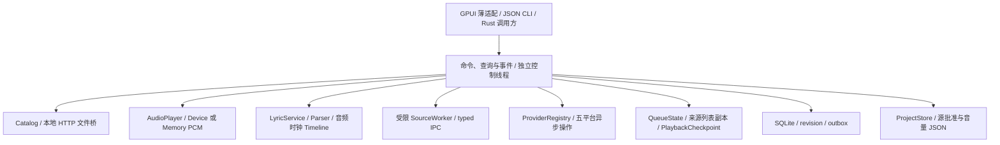

# LX Native 后端开发状态

后端 CLI 交付检查点为 **0.3.0-alpha.14**，其数据库 schema 为 **16**；开发源码的 schema **17** 下载分配账本与线程接线仍在验证前整合。验证范围与缓存供给性能失败见[检查点记录](backend-checkpoint-alpha14.md)。现有桌面发行产物为 0.2.0。完整移植的兼容基线为 LX Music Desktop v2.12.6 提交 `ad95d5091c9ed689fa72b5e5c849df65f5a679ce`。工程范围与阶段退出标准见 [移植规划](backend-port-plan.md)。列表、持久队列、流式播放、已批准源预加载、缓存 I/O 隔离、资产预加载、跨平台匹配、持久 URL/图片缓存、编码复用与标签编辑具有后端执行链路。类型检查、定向测试和完整发行验收分别记录。

音频分析、空间声与卷积资源已接入持久偏好、实际渲染、后端命令和 CLI；13 个原版卷积预设按需解码，准备银行、热切换及设备交接具有定向行为验证。压缩器采用固定兼容默认参数，完整硬件验收仍待完成。定时停止提供单调倒计时、到期暂停或已呈现曲目的曲终等待、自动续播拦截、持久选项与备份映射，见 [定时停止接口](backend-timeout-stop.md)。定时器核心的原始源码定向测试与实际后端播放集成测试分别验收。原生 SQLite 快照、系统媒体控制、热键、设备实机性能与完整打包仍有未完成工作。

音效设备交接已覆盖真实响应银行的跨格式保留、未呈现取消重定向、故障后拥有者捕获及硬失效退休，验收范围见 [音效交接](backend-effects-handoff.md)。物理 SQLite 快照有独立命令、查询和 schema 14 恢复账本；接口见 [物理快照](backend-physical-snapshot.md)，后台执行与文件系统恢复分别验收。

## 服务结构

开发源码提供音效持久设置、WAV/FLAC 响应资源库、准备操作、实际呈现状态及 CLI 接线，见[音效接口](backend-effects-api.md)。播放中的同格式热切换保持媒体实例，实际前缀呈现后将新媒体与旧响应尾音混合；失败导入回收等待持久确认与实际线程退出。112 项音频与资源定向测试、5 项实际后端回收故障测试通过。标签额度缓存重新核对完整 SQL 内容，24 项仓库测试通过，同等大文档压力覆盖耗时为 332.97 秒。备份恢复保留当前资源权限和操作库存；父 manifest 终态恢复已覆盖真实创建记录及伪目标、伪文件身份拒绝。系统自身持久恢复事务联测及完整实机验收仍待完成。已交付 CLI 检查点为 0.3.0-alpha.14，上述开发源码尚未重新打包。

资源命名空间的冷恢复提供 `recover_impulse_namespace`，以本次实际目录及所有者文件选择重新批准；保留写句柄后的重试继续校验原始授权、当前实际身份与完整内容。物理恢复覆盖当前授权快照和同步数据集重新协商，SQLite 真正关闭后保留完整主文件证明；后端交接与回滚须完成实际证明句柄关闭。72 项资源、授权、物理恢复和交接定向测试通过，另有 6 项原生恢复、5 项公开交接及 18 项 CLI 用例通过。默认 WAL／SHM 创建所有权、50k 曲库物理恢复容量与完整物理恢复 Backend／CLI 生命周期仍待验收。

LX v4 同步核心与固定官方源码进程的双向验证覆盖 14 项首次同步模式、28 项编码与数据配额、16 项元数据比较边界，以及 4 项冲突重连、保存凭据冷启动、撤销和宽松元数据合并。元数据数字字符串使用原版比较规则，标识符仍严格区分；完整 Rust 同步协议与线程拥有者回归共 25 项通过。重连双方的完整数据摘要一致，进程实际退出，停止后的连接、RPC 和内存额度归零。官方核心运行适配与完整官方桌面应用互通分别验收，后者仍待完成。

Windows 锁定依赖的原始版权和许可文件及其校验摘要见 [依赖清单](../licenses/dependency-manifest.json) 和 [NOTICE](../NOTICE)。1115 份版权或许可原文及 `mac-0.1.1` 的原始声明已校验；该组件的完整许可文本及两项后补许可的适用关系仍待确认。13 个 MPL-2.0 组件的完整锁定源码分发包附于 [源码清单](../licenses/third-party-source-manifest.json)，源码文件与实际依赖目录逐项一致；完整发行许可审计仍须结合最终构建与打包结果。

后端不依赖 GPUI。`ui` feature 控制 GPUI Kit、文件选择器及桌面入口；CLI、领域、仓库、音频、源和歌词模块可以使用 `--no-default-features` 构建。`controller.rs` 仅映射既有界面命令和投影快照，不维护另一套播放器持久化或源运行时。

| 模块 | 当前可用行为 | 尚缺边界 |
| --- | --- | --- |
| 领域 DTO | 平台 ID/质量、现代与旧 LX 音乐 DTO、未知扩展字段、稳定本地身份、四轨 Missing/Null/Text、列表/Dislike 类型 | 全量历史备份格式与跨版本导入 |
| 后端 | 有界命令、快照、本地搜索、异步 provider、typed 列表/Dislike/队列 query/command、revision 冲突、request_id 重放、取消与关机；显式启动的 LX OpenAPI 与 SSE；actor 异常保留及[连续锁交接](backend-profile-handover.md) | 幂等及 provider 结果缓存不持久；完整列表/队列前端仍缺 |
| 五平台 SDK | 活动元数据/歌词/封面，分页/ID/质量与 typed error；已接显式保存 provider tracks、列表播放及内置歌词路由 | 全部真实分支/分页/质量尚未联测，真实候选换源与URL信息缓存已接入，持久图片/编码音频复用及有限HTTP恢复已接入，本地匹配与完整服务联测未完成，见[SDK 状态](sdk-status.md) |
| SQLite | 曲库、四轨歌词、列表、队列、revision/outbox、目录监听与重定位绑定、下载任务和文件账本、同步快照和游标、迁移备份及连续 writer 锁；schema 16 标签写许可、事务与实际退休账本 | 物理文件组的完整冷恢复与终态清理、标签冷恢复剩余窗口 |
| 本地文件 | 明确文件选择、目录授权与后台扫描、监听、重定位、标签读取、同句柄探测和流式 HTTP/Range，见[本地曲库接口](local-library.md)；MP3/FLAC 同句柄安装、实际退役与[Backend/CLI 标签协议](backend-tag-edit-api.md) | 标签完整故障矩阵、播放占用联测、扫描控制延迟及完整曲库维护验收 |
| 源运行时 | 精确批准、worker 初始化/切换/取消、受控 HTTP、Buffer 方法面、RSA helper、有界 timers、typed host event、URL/歌词 IPC | DOM、Node I/O、永久后台 event loop、自动更新和 DevTools UI |
| 歌词 | 同名 LRC/KRC/标签、原生 codec、四轨编辑/导出/时钟；当前列表副本的内置平台或已批准 local resolver 路由 | 全部曲目/格式/分页的在线联测、桌面歌词窗口 |
| 音频 | 按块 HTTP/Range、显式 Symphonia 解码、有限 PCM 与 CPAL/Memory 渲染；有界 Range 预取、设备交接、静音、十段EQ、倍速保调、独立移调、13 个原版卷积预设、卷积资源银行、固定压缩器、空间声及分析，见[设备接口](audio-output.md)、[播放处理接口](playback-processing.md)与[音效接口](backend-effects-api.md) | 长期供给压力、完整文件系统故障及硬件输出验收 |
| 队列 | 五模式、预选/历史/临时 FIFO、资格过滤、列表变更、SQLite 检查点及暂停重启；实际候选匹配、批准源预加载与原资源提升 | 异常恢复分支、恢复 seek 与大曲库性能验收 |
| OpenAPI | 13 个 LX 路由、真实 HTTP/SSE、认证和 Origin 校验、已验证当前图片租约；22 项协议测试和 9 项实际后端测试通过，见[接口说明](open-api.md) | 系统媒体会话、系统热键和协议注册 |
| 系统控制 | 持久设置、统一 actor 命令桥、配置与 generation 校验、取消和失败恢复；8 项公共后端测试及 18 项资源与回滚测试通过，见[系统控制接口](backend-system-control.md) | 原生媒体会话、热键、电源通知、协议注册与同用户深链的桌面验收 |
| 下载 | 持久任务、实际传输与恢复、标签/封面/内嵌歌词/旁车后处理、原发布文件的重试；15 项真实后端案例通过 | 覆盖事务、下载成品本地播放入口及完整压力和故障验收 |
| 原生恢复 | sealed 预览、单事务库数据与归档导入、当前授权保留、偏好恢复 saga，见[恢复接口](backend-native-restore.md)；同 acquisition 的 Guard 交接及[去除权限的物理候选库](backend-physical-restore.md) | SQLite/JSON 成组物理安装与失败回滚、物理恢复 Backend/CLI 入口及完整重启验收 |

## 后端协议

`BackendHandle` 由独立控制线程处理命令。命令队列最多64项；事件保留最近256条。查询返回快照或分页数据，不暴露播放器内部可变状态。

`CommandEnvelope` 包含 `request_id`、`origin`、可选 `expected_revision` 和展平命令。request/origin 标识限 128 字节，request_id 必须非空。同一实例的有限缓存内，相同 ID 和输入复用 receipt，不同输入返回 Conflict；重启后不保证幂等去重。

| Receipt | 含义 |
| --- | --- |
| Applied | 动作交给服务；不表示设备发声或异步音频已收敛 |
| Committed | 持久化修改已提交，状态与事件随后投影 |
| Accepted | 后台操作已开始，等待相同 operation_id 的终态或取消 |
| Completed | 已结束操作的幂等重放 receipt |

`StateChanged`、`OperationFinished`、`ProviderFinished`、`SourceHostEvent`、`LyricChanged`、`LyricFrameChanged` 和 `Stopped` 事件包含事件序号、repository revision 与可用的 operation/origin 上下文。游标不能跨进程复用。

`ProviderRequest` 在独立工作线程调度，控制线程继续处理查询、音频控制及取消。`provider_result(operation_id)` 返回 running/completed/failed 状态、`ProviderResponse` 或 `ProviderError`；取消以 failed 和 typed Cancelled 错误表示。操作结果保留在有界会话缓存；查询已逐出结果会报错。普通 SDK 查询不自动修改列表或播放；同一会话内可显式 `save_provider_tracks`，随后通过列表命令选择和播放，在线歌词进入 LyricService 优先级及缓存。

首次订阅或 CursorExpired 后，CLI 使用 `{"query":"snapshot_cursor"}` 获取原子配对的 `result.snapshot/result.cursor`，替换本地状态后，再发送 `{"query":"events","cursor":返回值}`。每次处理完事件更新 cursor 为最后一个 event_id。`{"query":"event_cursor"}` 仅获取当前游标，适合只接收未来事件、不重建状态的调用方；Rust 对应 `snapshot_with_cursor()` 与 `event_cursor()`。

`shutdown(timeout)` 取消源、文件和歌词操作，停止音频与本地 HTTP，报告等待结果。CLI 的正常 EOF 执行显式关机；Accepted 不等于任务完成。

## CLI 与 profile

CLI 默认 `--audio memory`，可指定 `--audio device`。单次命令等待异步终态；`--json-lines` 立即返回 receipt，允许同一连接继续查询和取消。普通无效 JSON/命令返回该行错误，后续行继续处理；单行最大2 MiB，超限终止连接并关机。

| 数据目录 | 位置 |
| --- | --- |
| Windows 默认 | `%LOCALAPPDATA%\LXNative` |
| Linux 默认 | `$XDG_DATA_HOME/lx-native`；未设置时 `$HOME/.local/share/lx-native` |
| `--portable` | 可执行文件目录的 `userdata` |
| `--data-dir PATH` | 指定 profile，优先于 portable |

每个 profile 只允许一个后端 writer。Windows 长驻 CLI 可用 `--instance-relay --json-lines` 显式启动同用户 DeepLink 服务；第二个 CLI 的 DeepLink 转发进入该实例的普通 actor，保留 request ID、源批准与媒体 URL 批准规则，见[单实例接口](backend-instance-relay.md)。查询和其他命令使用长驻实例或显式启用的 OpenAPI。GPUI 的命令行 URI 与窗口激活仍待接线。显式指定旧 `userdata` 可迁移原 JSON 文件映射，不读取其他 LX Music、浏览器或系统凭证目录。

构建与调用示例见 [README](../README.md#cli)。除 status、tracks、events、cursor、lyrics 与 provider_result 外，typed 查询还包括 `list_infos/list_tracks/list_track/list_positions/list_update_infos/dislike_rules/search_history/queue/playback_checkpoint/rendered_pcm`。`list_tracks` 使用 offset/limit 返回该页及 repository revision，单项 `list_track` 按 list_id 和 music_id 读取精确副本。

列表与队列命令包括 `list_action/dislike_action/select_list/play_list_track/save_provider_tracks/enqueue/remove_queue_entry/clear_temporary_queue/set_play_mode/set_playback_quality/set_auto_skip_on_error/dislike_current/set_list_position/set_list_update_info/record_search/remove_search_history/clear_search_history`；各命令使用 `CommandEnvelope` 和其版本/重放规则。位置参数、模式及质量为 typed 数据，不接受任意脚本执行。

单次 CLI 入口还提供 `lists`、`list LIST_ID`、`queue`、`play-list LIST_ID MUSIC_ID`。provider 结果只属于当前后端会话，不能在另一个单次 CLI 进程中复用旧 operation_id。保存到列表后，曲目可在新进程通过列表查询和 playback checkpoint 恢复。

## 持久化与迁移

`native-library.sqlite3` 的当前 schema 为 16，具有独立 application_id、外键、WAL 与 FULL 同步。Repository 连接通过互斥串行访问，OS 文件锁阻止同 profile 的第二个 writer。

| 存储 | 真源及事务内容 |
| --- | --- |
| `player-state.json` | 精确脚本、批准/策略版本、选择与音量；原子替换及备份 |
| `tracks/local_assets` | 曲目和授权文件映射；批量一事务、一条 outbox，任一失败全回滚 |
| `local_file_grants/local_asset_locations` | 独立显式文件授权 epoch、当前规范路径与已验证物理身份；目录扫描不创建显式文件授权 |
| `library_roots/library_membership` | 目录 anchor、授权 epoch、递归范围、扫描 generation 与多目录成员关系；撤销保留用户曲目及列表 |
| `library_scan_runs/library_scan_seen` | 有界扫描状态、事务计数和发现清单；完整发现才执行缺失判定，取消及不完整扫描保留未访问成员 |
| `lyric_bundles/lyric_fields` | `(track_id, origin, kind)` 唯一四轨；origin 为 raw/edited；整包替换保留字段状态 |
| `repository_state/change_outbox` | 单调 revision 和提交后变更；ack 清记录但不回退 revision |
| `import_markers` | 一次性旧 JSON 文件映射迁移与摘要 |
| `profile_metadata` | JSON profile 摘要，不复制源授权或私钥 |
| `music_lists/music_list_items` | 三个保留列表及有序用户列表、独立曲目文档、来源/滚动位置/更新时间；跨列表移动与 revision/outbox 单事务 |
| `dislike_state` | 原始文本规则及按 `@/#`、trim/lowercase、Set 规则生成的匹配投影 |
| `search_history` | 大小写精确匹配、去重后的最近使用顺序，最多 15 项 |
| `artwork_info/artwork_blobs` | 图片来源/上下文/TTL、独立URL批准和完整验证的SHA去重编码字节；纯缓存事务不增加用户 revision/outbox |
| `resolved_media/source_matches` | URL信息及真实候选、解析/原曲DTO摘要、TTL与失效状态；纯缓存事务不增加用户 revision/outbox |
| `playback_state` | 完整 QueueState、position_ms、lyric_offset_ms、quality、auto_skip_on_error 和 auto_switch_source；与 revision/outbox 同事务提交 |

首次迁移保留旧 JSON，把原本已选文件转为稳定映射。随后本地库以 SQLite 为真源，JSON 旧文件数组不会再次覆盖仓。源批准与音量继续由 ProjectStore 保存。

schema 升级前用 SQLite online backup 保存完整数据库，迁移在事务中执行，失败回滚 DDL 和版本号。未知新 schema、损坏数据库和不匹配 application_id 拒绝写入；`backup_to` 包含已提交 WAL 数据并拒绝覆盖既有目标。

JSON 保存与 SQLite 摘要是两个存储。摘要写入失败时后端尝试恢复原 JSON，启动时核对实际 profile 摘要与 revision。恢复失败报告存储错误，不声称具备原生跨文件事务。

### 列表、Dislike 与历史仓库

`ListAction` 覆盖整个列表数据、创建、删除、更新、列表位置、歌曲覆盖/添加/跨列表移动/删除/更新/清空/位置，共 12 种动作。`MusicAdd/MusicMove` 按 LX 曲目 ID 去重，保留现有目标曲目，支持 top/bottom；跨列表移动会删除来源中选中的曲目，即使目标已有该曲目。覆盖操作的重复 ID 返回事务错误。保留列表 `default/love/temp` 可以修改歌曲，不能作为用户列表删除。

`list_tracks` 返回列表自身的完整曲目文档；注册缺少的全局 track ID 不覆盖已有全局元数据。整个数据覆盖时，未给出的 temp 歌曲保持原值；仍存在的用户列表保留滚动位置和自动更新配置，删除的列表级信息随其清除。`temp.meta.id` 保留临时列表引用。用户列表位置更新遵循固定后端分支的多选排序和 `location_update_time` 行为。

`list_positions/set_list_position` 管理滚动位置，`list_update_infos/set_list_update_info` 管理来源刷新时间和自动更新标志。歌曲普通修改不会把 `update_time` 改成当前时间，刷新服务必须在成功后显式提交刷新信息。写操作检查 `expected_revision`，仅在数据、revision 和 outbox 提交成功后返回变更。

Dislike 保持文本规则的歌曲名、歌手名和组合匹配；曲目中的 `@` 按 `#` 别名规范化，名称转小写并去除 LX trim 字符。搜索历史是精确字符串 MRU，重复项移到最前；已经位于最前的词是 no-op，revision/outbox 不变。列表双端 SQL 失败、重复 ID、冲突、重启及 schema 迁移/DDL 回滚由 SQLite 集成测试覆盖。

`domain::list_tools` 提供五字段升降序、可注入 Fisher-Yates、名称版本括号的重复组发现及名称→歌手→专辑→模糊分级搜索。返回原索引，保持列表文档；重复组包含全部成员，不自动删除。ICU 比较器使用显式 locale，默认 zh-Hans-CN；Node golden 记录 ICU/CLDR 版本，排序库版本和非一致 NaN 时间比较具有明确兼容边界。搜索的非 Unicode 正则匹配与编辑距离按 UTF-16 执行，含大小写/换行和工作预算。工具当前为独立 Rust API，不能从 CLI 已有列表查询推导完整前端排序/去重功能。

### 队列与播放检查点

`playback::queue::QueueState` 实现 `listLoop/random/list/singleLoop/none`，区分手动切歌、自然结束及失败；重复曲目使用独立 entry identity。控制线程采用同一状态机处理来源列表、预选/提交、随机历史、临时插队和资格过滤。临时条目保留来源列表及其副本文档，播放时不以全局 track metadata 替代。

普通 `remove_queue_entry` 删除该条目对应的持久列表成员；temporary 条目仅操作临时 FIFO，`clear_temporary_queue` 不删除持久歌曲。`catalog` 是只读虚拟集合，其普通条目不能通过移除队列命令删除。持久 `temp` 列表不等于 temporary FIFO。当前成员删除或列表删除会使旧解析 generation 失效，暂停时不会因修复队列而重新发声。

播放检查点写入 schema 8 的 `playback_state`。恢复队列、当前位置、质量、错误跳过/切源开关与歌词 offset 后保持暂停候选，显式播放/继续才恢复解析和音频加载；重启不自动创建 SourceWorker 或下载音频。检查点专用限额 32 MiB，不扩大其他文档的 8 MiB 上限。真实 SQLite 保存及重启覆盖 50000 条队列；这项持久化验证不证明大曲库控制响应 p95、全程峰值内存或完整性能验收。

在线闭环经过真实自建 HTTP/SourceWorker 验证：SDK 结果显式保存到 default/love，各列表副本分别参与 URL 和歌词解析；陌生音频 URL 审批前零下载请求，审批后 Memory PCM 产生有效样本。显式 `play_list_track.quality` 严格匹配已批准源与曲目声明，不满足时报 Unavailable；全局 preferred quality 的常规协商只在已声明兼容质量中选择。解析失败及错误跳过期间的 Pause 保持无声；实际音频结束、手动切歌、当前删除和暂停重启行为具有集成测试。

### 流式音频与预加载

媒体链为限定HTTP/1客户端、AudioTransport、可等待Read/Seek的StreamMediaSource、显式Symphonia decoder、有限PCM及直接CPAL/Memory内核。正常EOF、短响应、解码错误、表示变化与取消分别处理；断流补零及暂停不推进内容钟，静音正常推进。输出数据回调的应用路径不执行锁、堆分配/销毁、I/O或解码，source所有权通过有界队列回到拥有者回收。

已批准源的预加载使用同一Ended队列预选，候选质量独立于当前曲质量。`preload` 查询、`approve_preload_url` 和 `cancel_preload` 对应解析、精确URL批准、准备与撤销；批准前媒体GET为零。单engine保留一个投机decoder/transport/PCM source，nonce、播放generation、队列/source/approval fence、缓存及表示epoch通过后才提升。异步输出失败或资源失效回到候选曲的普通解析与新URL审批。

已授权本地文件和原创catalog音频以独立CatalogAsset authority预加载，资产ID及内容stamp约束准备，source SHA为空且policy为0。既有文件批准覆盖其精确本地URI；未经显式选择或登记的文件不会由该authority获得读取权。资产重新导入后旧准备资源取消，正常加载使用新内容。

强 ETag、已知总长及实际 206 能力确认后，传输最多预取后续两个块，优先满足当前读取需求。投机字节预算、缓存容量、seek epoch 和取消仍约束每次请求；弱验证、未知总长及 200 响应不扩展 Range 预取。80 ms 准备 PCM 环保持原容量，完整倍速与预加载提升的 6 项 Memory PCM 后端测试通过；六项实际 HTTP 测试覆盖预算、容量、seek 中断、表示变化和预取失败。

缓存I/O worker执行异步bootstrap、发布、持久登记、审核与退休回收。控制端保持短锁，reader使用proof/hazard在锁外读盘；物理删除与登记成功前保持quota占用。Engine、decoder、cache及Runtime通过有界预预约supervisor持有真实thread handle，超时可重join，Drop仅取消/唤醒。

播放解析、投机解析及local歌词共用一个JS会话，前台工作优先；普通operation取消清理HTTP/timer/job并保留闭包，停用/删除/换源/关闭终止进程。同步JS/native调用仍由既有CPU/迭代限额约束。

`audio_cache_stats` 返回RAM、实际物理磁盘、encoded bytes、lease/pin、延期块、foreign/cannotClear及恢复统计。`clear_audio_cache` 是Accepted操作，成功后发布AudioCacheCleared与终态；陌生文件保留且明确失败。登记、OS锁、ownership header支持死亡owner冷恢复，当前stream serial对象不跨播放或重启复用。具体配额、表示一致性与剩余I/O边界见[流式架构](streaming-architecture.md)。

## 本地文件与元数据

首次入库的 `local_track_id` 由 canonical 授权路径的规范身份生成完整 SHA-256。Windows 使用默认不区分大小写的路径身份，其他平台保留路径字节。该 ID 不等于内容哈希；重定位通过文件身份与内容证据保留曲目身份。显式文件授权仍约束已选择的名称，不随移动扩大读取范围。

导入检查扩展名、普通非空文件与真实解码样本，仓库事务提交后才发布到 Catalog。支持 WAV、MP3、FLAC、OGG/OGA、M4A/MP4/AAC。标签可读时采用标题、艺术家列表、专辑和时长；标签失败报告警告，音频可按文件名及探测结果入库。封面读取不代表界面显示、标签写入或批量扫描完成。

`library::scan::discover` 是独立的显式目录发现 API，返回文件路径、大小、mtime 与有界 warning；按音频扩展名筛选，可配置递归并执行取消、期限及文件/目录/深度/报告字节预算。链接或 Windows reparse point 不扩大目录授权，超预算不会报告完整成功。目录授权、后台扫描、分批入库与监听通过[本地曲库服务](local-library.md)接入；标签读写、安装协调器及实际退休通过[标签 API](backend-tag-edit-api.md)接入，完整故障矩阵单独验收。

本地 HTTP 仅监听 loopback，请求时打开文件，以64 KiB缓冲复制选中范围；支持 GET/HEAD、单段 Range、ETag/If-Range、206/416。端口可随进程改变，曲目身份与文件映射不依赖端口。

入库、文件桥和生产播放使用有界读取；68 MiB原创WAV已通过实际Memory首PCM、中尾seek、EOF及重播验证。持续21秒的第二块传输验证补零时内容钟冻结、恢复后真实尾段PCM及控制关闭；硬件输出另作验收。

## 四轨歌词闭环

`LyricBundle` 包含 `lyric/tlyric/rlyric/lxlyric`。Missing 表示未提供或尚未获取，Null 表示不可用，`Text("")` 表示已获取为空。JSON 和 SQLite state/text 保留这些区别。

选择顺序保留有效 timed edited 主轨整包、本地同名旁车/标签和有效 raw cache；缺少有效结果时使用已批准的 local resolver，或在线曲目对应的内置平台 resolver。空旁车和已获取空原文是有效结果。强制 resolver refresh 是独立服务选项，不清除用户编辑；普通 backend `load_lyrics` 使用当前播放曲目的列表副本及常规优先级。

本地读取仅检查音频的同名 `.lrc/.krc` 和标签，不枚举目录；优先有效 LRC，再读取 KRC，随后读取标签。LRC 编码支持 UTF-8（含BOM）、UTF-16LE/BE 的 BOM及受限检测、严格GBK回退；指向所选目录外的旁车链接拒绝。KRC 容器使用原生解码并保留翻译、罗马音和字时间。

LRC/LX parser 有固定 LX 兼容模式和规范模式，支持多标签、同时间扩展、翻译/罗马音精确时间关联、offset 和相对词时间。默认兼容模式保留全文件毫秒模式与混合小数时间的历史语义。KRC/QRC/MRC/YRC 供应商容器不直接作为 LX 文本解析。

`lyrics::codec` 提供有界 KRC/QRC/MRC 解码和转换；KW 二进制动态歌词、WY YRC 及翻译/罗马音标签归一化位于平台 adapter。容器、实际密文、字时间、混合轨和异常输入具有独立 fixture。五平台 `Lyrics` 已接当前播放的 LyricService 路由，使用取消及 generation 校验；官方样例与内置 HTTP/Memory 闭环分列验证，不能据此宣称全部曲目均提供歌词。

后台 `prepare` 完成读取/解析，`commit` 核对 track、音频 generation、取消 token 和 repository revision 后再写 raw、发布状态和事件。编辑是四轨整包事务；恢复原文删除 edited；清 raw 保留 edited。获取失败更新 `lyrics_error`，不会停止正常音频。

Timeline 使用音频时钟，输出行/字位置和进度、翻译、罗马音与扩展文本；暂停不自行推进，seek 后重定位，切歌丢弃迟到 generation。offset 限±24小时，随播放检查点保存；rate 使用实际渲染确认的倍速，延迟内容的原始媒体位置随有效输出标签推进。

`lyrics` 可指定 raw/edited；省略 origin 时优先返回文本主轨的 edited，含空编辑。播放覆盖要求有效非空 timed 主轨，两种选择分别用于数据编辑与播放。

导出返回 LRC 主轨、LX 轨、四轨 JSON 或 awlrc Base64 容器的文本/MIME/扩展名。JSON保留 Missing/Null，awlrc保存可用文本轨。歌词文本导出不写文件、不启动源、不写标签；下载任务另有实际标签、内嵌歌词和旁车写入链路，并支持已发布文件的后处理重试。

## 自定义源与 typed IPC

静态校验仅解析元数据和语法。批准绑定脚本 SHA-256 和策略版本2；旧策略或内容失配撤销批准及自动选择。专属 worker 持有执行会话，切源、停用、删除、取消和关机终止旧进程与网络请求。

支持 `lx.on(request)` / `lx.send(inited)`、处理器替换、Promise/thenable 和会话闭包。manifest 过滤平台、动作与质量。`musicUrl` 可声明 kw/kg/tx/wy/mg/local，pic/lyric 仅local；搜索、榜单、歌单与内置在线歌词由独立 Rust SDK 提供。

`SourceResult::Lyrics` 与 worker Lyrics 响应返回对象，URL 使用独立类型，不能互换。local `lyric` 必须为字符串；扩展轨保留缺失/null/空文本，接受下列UTF-16与总字节限额。

HTTP 有独立取消函数，支持显式方法、headers、body/form/formData、timeout 和 `(err,resp,body)` 回调。I/O 在宿主任务运行，Boa值与回调留在runtime线程。`setTimeout/setInterval/clearTimeout/clearInterval` 使用当前 operation 的有界调度；Promise 微任务在 timer 回调之间处理。新 resolver operation、完成、取消和切源清除遗留 HTTP 与 timers，闭包状态可以保留，不提供永久后台 event loop。

Buffer 覆盖 Node 24.19 fixture 验证的方法面：构造/编码、ArrayBuffer 共享视图、复制/搜索/比较、整数、Float/Double、64 位 BigInt、swap、JSON 和 inspect。分配限额与 Node 内存池不同，`allocUnsafe` 返回清零内存。工具提供 MD5、系统随机字节、AES-128/192/256 CBC/ECB PKCS#7、Promise zlib 及 1024 位 `rsaEncrypt` 公钥无填充运算；接受 SPKI/PKCS#1 公钥 PEM，或从未加密私钥 PEM 提取公钥部分，均不执行私钥解密。

`lx.send(updateAlert)` 与初始化 `openDevTools` 产生 `SourceHostEvent`，通过 worker IPC 返回并投影后端事件。更新提示每会话最多一次，URL 和文本受限；宿主不自动下载更新、打开链接或创建 DevTools 窗口。DOM、其他 AES 模式、Node 模块/I/O 与无限后台 timers 尚无实现。

## 执行与资源限制

| 内容 | 限额及行为 |
| --- | --- |
| 脚本 / IPC | 脚本 1 MiB；IPC 2 MiB |
| 元数据字段 | UTF-16 截取：name 24、description/version 36、author 56、homepage 1024；超长追加 `...`，重复字段取后值 |
| worker | Windows Job 512 MiB/单进程；语法 5 秒；初始化/解析 70 秒、IPC 75 秒；微任务累计 5 秒/4096 jobs |
| HTTP | body 1 MiB、响应 2 MiB；默认/最大 timeout 60 秒；每操作 8 并发/128 请求；完成队列有界 |
| URL | 结果 ≤2048 UTF-16 units，拒绝 URL 凭证；脚本 HTTP URL ≤8192 字节 |
| Buffer / zlib | Buffer 及压缩/解压输出 ≤2 MiB；累计输出阶段限额 |
| RSA helper | 输入/输出 128 字节；1024 位公钥；PEM 输入 ≤16 KiB；RSA_NO_PADDING |
| timers / host event | delay 1–60000 ms；pending 64、每 operation 创建 256/回调 512；host event 每 operation 16、缓存 64 |
| 内置 SDK | 操作默认 20 秒、最大 120 秒；并行 4；结果缓存 32 项/64 MiB；HTTP 响应默认 8 MiB，显式配置上限 64 MiB |
| 四轨歌词 | 总 UTF-8 文本 2 MiB、无 NUL；旁车输入 2 MiB |
| local 源歌词 | lyric ≤51200 UTF-16 units；tlyric/rlyric 各 <5120；lxlyric <8192 |
| parser | 最多 100000 行/500000 词项 |
| 音频元数据 | 读取 16 MiB；文本字段 8 KiB；歌手 128 项；每 tag 4096 项；压缩 ID3 帧不支持 |
| 封面 | 单张 8 MiB、总 16 MiB、最多 16 张；识别图片文件头 |
| 仓库输入 | 普通文档 8 MiB；播放检查点专用 32 MiB；本地文件批量 1–1000 项/JSON 32 MiB；单列表最多 100000 曲目，仍受文档限额；outbox 单页 1000 项 |
| 显式目录发现 | 文件 50000、entry 250000、目录 10000、深度 64；报告 8 MiB、warning 256；取消/期限/预算有明确结果 |
| 流式音频 | 默认块 256 KiB、RAM cache 8 MiB、PCM 全局 8 MiB、磁盘 512 MiB；HTTP DATA/协议读取 8 KiB、响应头最多64项；等待数据 idle 20秒 |

微任务预算不表示同步JavaScript可在5秒时抢占；循环/递归限制、子进程和IPC硬期限共同约束执行。脚本无文件系统、shell、环境变量和原生模块访问。

源HTTP允许公网和工程loopback，拒绝LAN/link-local/元数据等非公开地址；DNS后固定连接地址并保留TLS主机校验。不关闭证书验证、不跟随重定向、不读系统代理、不自动附带Cookie/系统凭证。脚本显式headers与发送数据属于其批准范围。

## 未完成能力

M05已接跨平台匹配、真实候选换源和持久URL信息缓存，接口与约束见[媒体解析](media-resolution.md)；图片缓存、跨播放编码复用及有限HTTP恢复见[图片接口](artwork-cache.md)与[编码复用](encoded-reuse.md)；本地跨平台匹配、其他恢复分支及完整服务联测继续推进。本地标签编辑已经提供独立写许可、同句柄安装、Repository 事务、Backend/CLI 命令及正常退休闭环，剩余冷恢复窗口见[标签编辑 API](backend-tag-edit-api.md)。剩余交付包括完整列表/队列前端、下载覆盖事务与成品播放、原生物理恢复、同步故障及真实 LX 联测、系统媒体与热键/协议注册、完整音效偏好和设备实机验收、性能与发行包回归。实际控制延迟与各文件系统故障条件分别验收。

CLI JSON Lines 提供工程控制协议，通过显式服务命令启动 LX OpenAPI 与 v4 同步。各协议服务、实际传输、目录、下载和设备行为由对应集成测试及实机验收确认。

## 验证范围

开发源码的无界面定向回归包含 357 项库测试和 99 项接口测试，全部通过；严格 Clippy 和格式检查通过。接口范围为音频传输 45 项、空间声 2 项、标签 Backend 3 项、CLI 15 项、原生标签安装 13 项及标签 Repository 21 项。库测试覆盖真实 IO worker 异常退出、未确认写入的 EOF、换表示与读代际隔离、回调中途真实 seek、卷积资源实际退休和物理恢复的进程退出场景。三项库用例和一项安装辅助入口按运行条件跳过，辅助进程由对应崩溃矩阵另行启动。

标签持久元数据的故障用例先验证原文件发生时间戳变化，再验证写入前容量拒绝保持原字节、纳秒级时间戳和绑定版本，并完成实际所有者与额度退休。当前操作的提交、回滚和退休记录容量已经准入；全局文档额度的并发峰值预留、完整物理冷恢复、持久卷积资源 Backend/CLI 接线、硬件与完整发行验收仍独立执行。上述源码验证不更新已留存的正式 CLI 或 GUI 产物结论。

验证分别使用锁定依赖运行headless与默认UI feature。临时profile、预览、日志和依赖缓存进入操作目录；正式源码与发布产物保留在工程目录。

自动化范围包括 DTO、LRC/LX parser/timeline、原生 codec、标签/旁车、四轨和列表/Dislike/history 事务、双列表失败回滚、迁移/未知 schema、队列规则与控制线程闭环、播放检查点/50000 条持久重启、ICU/UTF-16 列表工具及 1505 条 SQL 分页、显式目录发现与报告预算、文件 ID/Range、五 SDK 协议、实际 worker Buffer/RSA/timers/host-event IPC、授权/取消/迟到隔离、provider 与列表/队列 CLI、Memory PCM 和关机。专项闭环验证与完整回归结果分别记录，不以持久化成功替代大曲库响应性能。

2026-10-06 的官方样例联测覆盖五平台搜索、热词、标签、详情、封面、评论、榜单歌曲、歌单列表/详情与歌词；非空歌单搜索覆盖 KW/KG/WY/MG，TX 的合法空响应单列。KW 建议/专辑和普通/逐字榜单歌词、KG special 可用记录及指定三页调用亦有实证。全部分享/fallback/分页/回复和所有质量仍未逐项验收，见 [SDK 状态](sdk-status.md#验证范围)。官方元数据/歌词联测、合成音频的真实 HTTP/worker/Memory 集成测试和 Device 发声分别记录。

Device 音频、输出端点、扬声器发声和原生截图独立验收。[validation.md](validation.md) 与 [diagnostics.json](diagnostics.json) 记录保存的 0.2.0 包；当前源码验证应关联对应源码版本，不能沿用旧包结论。

统一验证记录：[alpha.11检查点](backend-checkpoint-alpha11.md)，77个套件770项通过、0项失败、2项物理设备测试跳过；fmt、严格无界面Clippy、默认GPUI全部目标编译与正式路径CLI烟测通过。缓存、输出及预加载边界见[流式架构](streaming-architecture.md)。历史记录保留[alpha.10检查点](backend-checkpoint-alpha10.md)、[alpha.9检查点](backend-checkpoint-alpha9.md)、[alpha.8检查点](backend-checkpoint-alpha8.md)、[alpha.7检查点](backend-checkpoint-alpha7.md)、[alpha.6检查点](backend-checkpoint-alpha6.md)、[alpha.5检查点](backend-checkpoint-alpha5.md)与[alpha.3检查点](backend-checkpoint-alpha3.md)。

设备偏好采用旧JSON字段默认值迁移，校验或保存失败保持原偏好和媒体状态。设备I/O由受监督拥有者执行；初始输出延迟到明确设备操作或已批准媒体的PCM准备完成，Memory选择与刷新不创建渲染线程。真实PCM静音时钟、重连/格式交接及实际join边界见[设备接口](audio-output.md)。M06音效和系统媒体工作继续实施。

十段EQ已接入Device/Memory共用渲染器、持久设置、CLI、状态和事件。固定Q1.4、九个上游预设、20ms双滤波器过渡、Nyquist高频保留参数且采用unity的策略，以及真实波形/声道/断流边界见[均衡器接口](equalizer.md)。受管空缓存引导中断只在根锁和全部精确所有权header可验证且没有命名空间、正文或外来文件时恢复；有数据或归属不明的记录保持拒绝覆盖。

倍速处理在已登记解码线程执行：保调使用固定WSOLA，非保调使用预制抗混叠sinc表；独立移调在共同输出链采用4096点FFT及预分配scratch。原始媒体标签与音频共同延迟，暂停和设备隔离保留未输出内容，seek建立新epoch；有限EOF排空后才发布结束。请求目标、实际确认、过渡余量和输出采样率单位的延迟见[播放处理接口](playback-processing.md)。

目录根、独立显式文件授权、位置及扫描仓采用schema 8。旧资产只在迁移时一次保留显式授权，目录成员不追加到JSON文件授权数组；启动从持久元数据建立懒路由，并在有界文件worker验证实际目录身份。Unknown、Verified、Unavailable和NeedsReapproval分别投影；授权intent不代替实际打开证明。Windows祖先FileId与Linux目录FD约束读取，精确旁车及音频/封面/歌词共享撤销检查。元数据、probe预算、事务ACK与最终关停边界见[本地曲库接口](local-library.md)。
